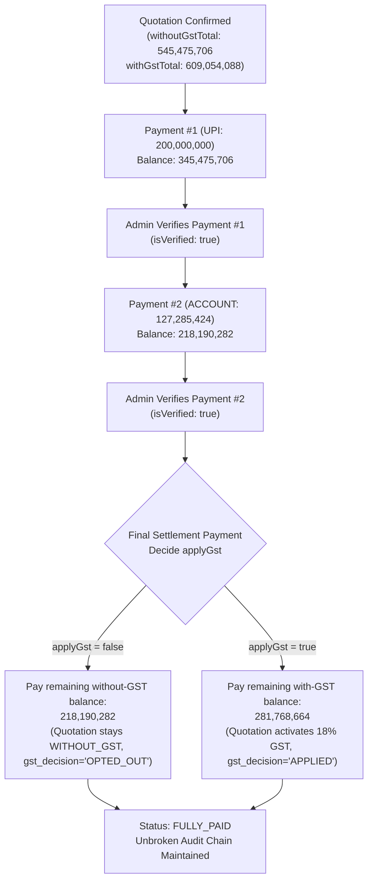
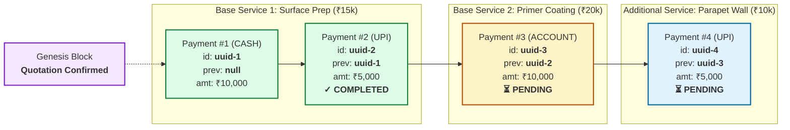

# 🔌 Dr. Terrace - Frontend & Mobile Integration Guide (API v2)

This document provides complete integration specifications, architecture contracts, endpoint references, and client-side code examples for connecting frontend applications (**React**, **Next.js**, **Vue**, **Angular**) and mobile clients (**Flutter**, **React Native**) to the **Dr. Terrace REST API Backend (v2)**.

---

## 📑 Table of Contents

1. [What's New in API v2](#1-whats-new-in-api-v2)
2. [Architecture & Base URLs](#2-architecture--base-urls)
3. [2-Tier Role-Based Access Control (RBAC)](#3-2-tier-role-based-access-control-rbac)
4. [Authentication & Profile Flow](#4-authentication--profile-flow)
5. [Complete REST API v2 Endpoints Reference](#5-complete-rest-api-v2-endpoints-reference)
   - [Authentication](#authentication)
   - [Appointments (Unified)](#appointments)
   - [Quotations (Unified)](#quotations)
     - [11. Confirm Quotation](#11-confirm-quotation-idconfirm)
     - [12. Unlock Quotation](#12-unlock-quotation-idunlock)
     - [13. Add Service from Existing Master Data](#13-add-service-from-existing-master-data-idservices)
   - [Quotation Payments & Direct Settlement (New Flow)](#quotation-payments--direct-settlement-new-simplified-flow)
     - [1. Get Payment Summary & History](#1-get-payment-summary--history)
     - [2. Record Intermediate Payment (Without GST)](#2-record-intermediate-payment-deducted-from-without-gst-total)
     - [3. Admin Verify Payment](#3-admin-verify-payment)
     - [4. Final Settlement Payment (Decide GST)](#4-final-settlement-payment-decide-gst)
     - [5. Rollback / Delete Payment (Admin Only)](#5-rollback--delete-latest-payment-admin-only)
   - [Payments & Blockchain Ledger (Unified)](#payments--blockchain-ledger-unified)
     - [1. Get Payment State / Pay-View](#1-get-payment-state--pay-view)
     - [2. Record Base Service Payment](#2-record-service-payment-base-scope)
     - [3. Add Variation Service](#3-add-additional-variation-service)
     - [4. Record Additional Service Payment](#4-record-additional-service-payment)
     - [5. Final Settlement & Deferred GST](#5-confirm-final-settlement--deferred-gst)
     - [6. Dynamic Pricing Configuration (GST & Discount)](#6-dynamic-pricing-configuration-gst--discount-toggles)
     - [7. Verify Blockchain Ledger Integrity](#7-verify-blockchain-ledger-integrity)
     - [8. Admin Verify Payment](#8-admin-verify-payment)
     - [9. Single Payment Verification View](#9-single-payment-verification-view)
     - [10. Record GST Clearance Payment](#10-record-gst-clearance-payment)
     - [11. Generate Final Official Receipt](#11-generate-final-official-receipt)
     - [12. Admin Toggle Receipt Lock](#12-admin-toggle-receipt-lock)
     - [13. Receipt Numbering Settings & Dynamic Series](#13-receipt-numbering-settings--dynamic-series)
     - [14. Delete Payment & Auto-Cleanup Rules](#14-delete-payment--auto-cleanup-rules)
     - [15. Clean Up Orphaned Payment Proof Images (Admin Only)](#15-clean-up-orphaned-payment-proof-images-admin-only)
   - [Warranty (Unified)](#warranty-unified)
     - [1. Check Warranty Eligibility](#1-check-warranty-eligibility)
     - [2. Get Warranty Config / Available Services](#2-get-warranty-config--available-services)
     - [3. Create Warranty Config](#3-create-warranty-config)
     - [4. Update Warranty Config](#4-update-warranty-config)
     - [5. Generate Warranty](#5-generate-warranty)
     - [6. Get Warranty](#6-get-warranty)
     - [7. Delete Warranty (3-Day Window)](#7-delete-warranty-3-day-window)
   - [Clients / Customers (Unified)](#clients--customers-unified)
   - [Appointment Schedules (Unified)](#appointment-schedules-unified)
   - [Company & Employee Policies (Unified)](#company--employee-policies-unified)
   - [System Health](#system-health)
   - [Home View Dashboard](#home-view-dashboard)
   - [Master Data & Dropdowns (Unified)](#master-data--dropdowns-unified)
     - [1. Waterproofing Locations](#1-waterproofing-locations-get-apiv2where-to-waterproof)
     - [2. Properties Catalog](#2-properties-catalog-get-apiv2properties)
     - [3. Packages Catalog](#3-packages-catalog-get-apiv2packages)
     - [4. Active Employees / Staff List](#4-active-employees--staff-list-get-apiv2employees)
     - [5. Bank Account Details](#5-bank-account-details-unified)
     - [6. Staff Management & Photo Upload](#6-staff-management--photo-upload-admin-only)
6. [Ready-to-Use Client Code Examples](#6-ready-to-use-client-code-examples)
   - [A. TypeScript / Axios Client with Interceptors](#a-typescript--axios-client-with-interceptors)
   - [B. React / Next.js Custom Hook](#b-react--nextjs-custom-hook)
   - [C. Flutter / Dart Mobile Service (Dio)](#c-flutter--dart-mobile-service)

---

## 1. Key Capabilities of API v2

| Area                    | Implementation Specification                                            |
| :---------------------- | :---------------------------------------------------------------------- |
| **Route Structure**     | **Unified canonical REST resources** under `/api/v2/*`                  |
| **Data Scoping**        | **Automatic query scoping** based on caller's token                     |
| **Database Engine**     | **TypeORM & TypeScript Entity Layer** with atomic transactions & pooled connections |
| **Book Appointments**   | **Enabled for Field Employees** (auto-assigned to self)                 |
| **Confirm Quotation**   | **Enabled for Field Employees** (for their assigned visits)             |
| **Reassign Technician** | Dedicated `PATCH /api/v2/appointments/:id/assign` (Admin only)          |
| **Check-in Attendance** | Standardized `POST /api/v2/appointments/:id/checkin`                    |
| **Direct Settlement**   | Dedicated `/api/v2/quotation-payments/:id` flow with without-GST intermediate payments and final GST decision |
| **Response Format**     | Standard `{ statusCode: 200, success: true, data: ..., meta: { ... } }` |
| **Client Screen Loading** | **1 Single Unified Request**: `GET /api/v2/clients/:id` bundles profile, packages, quotations, and active payment summary |
| **Post-Sale Warranty**  | New **Warranty module**: configure per-service warranty years after final receipt lock, with 3-day deletion window |
| **Bank Accounts**       | Full company account management via `/api/v2/account-details` with primary account toggle |
| **Storage Lifecycle**   | Automated disk unlinking on payment deletion & admin orphaned receipt cleanup (`/api/v2/payments/cleanup-orphaned-images`) |

---

## 2. Architecture & Base URLs

```
┌─────────────────────────────────────────────────────────────┐
│                      Client Layer                           │
│     Admin Web (React/Vite)  │  Field Mobile App (Flutter)   │
└──────────────────────────────┬──────────────────────────────┘
                               │ HTTP / JSON Bearer Token
                               ▼
┌─────────────────────────────────────────────────────────────┐
│              Dr. Terrace API Gateway (:9000)                │
│  - Universal CORS & Helmet Security                         │
│  - JwtAuthGuard (Extracts User & Role)                      │
│  - RolesGuard (@Roles(ADMIN, FIELD_EMPLOYEE))               │
│  - Automated Data Scoping (Admin: Global | Field: Scoped)   │
└──────────────────────────────┬──────────────────────────────┘
                               │ TypeORM DataSource / Entity Repository
                               ▼
┌─────────────────────────────────────────────────────────────┐
│              PostgreSQL Database (drterrace)                │
└─────────────────────────────────────────────────────────────┘
```

### Base URLs by Environment

| Environment               | Base URL                    | API v2 Prefix                      |
| :------------------------ | :-------------------------- | :--------------------------------- |
| **Local Web Development** | `http://localhost:9000`     | `http://localhost:9000/api/v2`     |
| **Android Emulator**      | `http://10.0.2.2:9000`      | `http://10.0.2.2:9000/api/v2`      |
| **iOS Simulator**         | `http://localhost:9000`     | `http://localhost:9000/api/v2`     |
| **Live / Production**     | `https://api.drterrace.com` | `https://api.drterrace.com/api/v2` |
---

## 3. 2-Tier Role-Based Access Control (RBAC)

API v2 defines two core operational roles:

1. **`ADMIN`**: Super Administrator & Office Administrator. Full oversight, staff dispatching, and system management.
2. **`FIELD_EMPLOYEE`**: Field Technicians & On-site staff. Autonomous on-site lead capture, site check-ins, drafting, and confirming quotes for their assigned visits.

### Capability Matrix

| Capability / Action            |               `ADMIN`                |            `FIELD_EMPLOYEE`            |
| :----------------------------- | :----------------------------------: | :------------------------------------: |
| **Login**                      | Username/Password or Mobile/Password |        Mobile Number / Password        |
| **View Appointments**          |          All company visits          | **Only** appointments assigned to them |
| **Book New Appointment**       |   Book & assign to any technician    |  **Enabled** (auto-assigned to self)   |
| **Reassign Technician**        |             **Allowed**              |           **403 Forbidden**            |
| **Site Check-in (Attendance)** |       Allowed (admin override)       |     **Allowed** (GPS + timestamp)      |
| **View Quotations**            |        All company quotations        |  **Only** quotations for their visits  |
| **Draft Quotations**           |               Allowed                |     **Allowed** (for their visits)     |
| **Confirm Quotation**          |               Allowed                |     **Allowed** (for their visits)     |
| **Home View Dashboard**        |     Company-wide upcoming/missed     |    **Scoped** to their daily visits    |

---

## 4. Authentication & Profile Flow

### 4.1 Login

Both Admin and Field Employees log in through the same endpoint.

```http
POST /api/v2/auth/login
Content-Type: application/json

{
  "username": "<admin_username_OR_employee_mobile_number>",
  "password": "<plain_text_password>"
}
```

#### Successful Response (`200 OK`)

```json
{
  "statusCode": 200,
  "success": true,
  "message": "Login successful",
  "data": {
    "token": "eyJhbGciOiJIUzI1NiIsInR5cCI6IkpXVCJ9...",
    "expiresAt": 1756400000000,
    "user": {
      "id": 102,
      "username": "9841999888",
      "name": "Karthik Raja",
      "role": "FIELD_EMPLOYEE"
    }
  },
  "token": "eyJhbGciOiJIUzI1NiIsInR5cCI6IkpXVCJ9...",
  "expiresAt": 1756400000000,
  "user": {
    "id": 102,
    "username": "9841999888",
    "name": "Karthik Raja",
    "role": "FIELD_EMPLOYEE"
  }
}
```

> [!TIP]
> **Uniform Envelope**: 100% of API v2 endpoints return their core response payload under the `data` property (`res.data`) and include `statusCode` (`200` or `201`). Convenience top-level keys (`res.token`, `res.user`, `res.appointments`, etc.) are also preserved for non-breaking compatibility.
>
> For root Admin logins (`admin`/`admin`), `user.id` is `0` and `user.role` is `"ADMIN"`.

---

### 4.2 Get Current User Profile

Validates token and returns current user permissions and role.

```http
GET /api/v2/auth/profile
Authorization: Bearer <jwt_token>
```

#### Response (`200 OK`)

```json
{
  "statusCode": 200,
  "success": true,
  "data": {
    "id": 102,
    "username": "9841999888",
    "name": "Karthik Raja",
    "role": "FIELD_EMPLOYEE",
    "isAdmin": false,
    "isFieldEmployee": true
  },
  "user": {
    "id": 102,
    "username": "9841999888",
    "name": "Karthik Raja",
    "role": "FIELD_EMPLOYEE",
    "isAdmin": false,
    "isFieldEmployee": true
  }
}
```

---

## 5. Complete REST API v2 Endpoints Reference

### Appointments

#### 1. List Appointments (Role-Scoped)

- **`ADMIN`**: Returns all appointments across the company.
- **`FIELD_EMPLOYEE`**: Automatically filtered to visits assigned to the logged-in technician.

```http
GET /api/v2/appointments?page=1&limit=20&search=Chennai&sortBy=appointment_date&order=desc
Authorization: Bearer <jwt_token>
```

##### Response (`200 OK`)

```json
{
  "statusCode": 200,
  "success": true,
  "meta": {
    "page": 1,
    "limit": 20,
    "totalItems": 45,
    "totalPages": 3,
    "hasNext": true,
    "hasPrev": false
  },
  "data": [
    {
      "id": 150,
      "clientName": "Rajesh Kumar",
      "mobileNumber": "9876543210",
      "appointmentDate": "2026-09-20",
      "appointmentFixDate": "2026-09-20",
      "appointmentTime": "10:30 AM",
      "googleLocation": "https://maps.google.com/?q=13.0827,80.2707",
      "assignedEmployeeId": 102,
      "employeeName": "Karthik Raja",
      "isAttended": false,
      "status": "SCHEDULED",
      "address": {
        "doorNo": "42-A",
        "streetName": "Gandhi Road",
        "area": "Anna Nagar",
        "city": "Chennai",
        "state": "Tamil Nadu",
        "pincode": "600040"
      }
    }
  ]
}
```

---

#### 2. Book New Appointment

Enabled for **Both Admin and Field Employees**.

- When booked by a **Field Employee**, `assignedEmployeeId` automatically defaults to the logged-in employee.
- When booked by an **Admin**, `assignedEmployeeId` specifies the assigned technician.

```http
POST /api/v2/appointments
Authorization: Bearer <jwt_token>
Content-Type: application/json

{
  "clientName": "Suresh Raina",
  "mobileNumber": "9887766554",
  "doorNo": "12/4",
  "streetName": "North Mada Street",
  "area": "Mylapore",
  "city": "Chennai",
  "state": "Tamil Nadu",
  "pincode": "600004",
  "googleLocation": "https://maps.google.com/?q=13.0334,80.2678",
  "appointmentDate": "2026-09-22",
  "appointmentTime": "14:00",
  "propertyId": 1,
  "whereToWaterproof": [1, 3],
  "assignedEmployeeId": 102
}
```

##### Response (`201 Created`)

```json
{
  "statusCode": 201,
  "success": true,
  "message": "Appointment booked successfully",
  "data": {
    "id": 151,
    "clientName": "Suresh Raina",
    "assignedEmployeeId": 102,
    "employeeName": "Karthik Raja",
    "status": "SCHEDULED"
  }
}
```

---

#### 3. View Appointment Details

```http
GET /api/v2/appointments/:id
Authorization: Bearer <jwt_token>
```

> Field staff can only view appointments assigned to them (attempting to view another technician's appointment returns `403 Forbidden`).

---

#### 4. Reassign Appointment (Admin Only)

Transfers an appointment to another technician.

```http
PATCH /api/v2/appointments/:id/assign
Authorization: Bearer <admin_jwt_token>
Content-Type: application/json

{
  "employeeId": 105
}
```

##### Response (`200 OK`)

```json
{
  "statusCode": 200,
  "success": true,
  "message": "Appointment reassigned to Ramesh Babu successfully",
  "data": {
    "id": 150,
    "assignedEmployeeId": 105,
    "employeeName": "Ramesh Babu"
  },
  "assignedEmployeeId": 105,
  "employeeName": "Ramesh Babu"
}
```

> [!CAUTION]
> If a Field Employee calls this endpoint, the backend returns `403 Forbidden` (`Admin access required`).

---

#### 5. Site Check-in (Attendance)

When the technician arrives at the site:

```http
POST /api/v2/appointments/:id/checkin
Authorization: Bearer <jwt_token>
Content-Type: application/json

{
  "date": "2026-09-20",
  "time": "10:45"
}
```

##### Response (`201 Created`)

```json
{
  "statusCode": 201,
  "success": true,
  "message": "Site visit check-in recorded successfully",
  "data": {
    "id": 89,
    "appointmentId": 150,
    "employeeId": 102,
    "date": "2026-09-20",
    "time": "10:45 AM",
    "createdAt": "2026-09-20T05:15:00.000Z"
  }
}
```

---

#### 6. Update Appointment Details

```http
PUT /api/v2/appointments/:id
Authorization: Bearer <jwt_token>
Content-Type: application/json

{
  "clientName": "Rajesh Kumar",
  "mobileNumber": "9876543210",
  "address": {
    "doorNo": "42-B",
    "streetName": "Gandhi Road Ext",
    "area": "Anna Nagar",
    "city": "Chennai",
    "state": "Tamil Nadu",
    "pincode": "600040"
  },
  "appointmentDate": "2026-09-22",
  "appointmentTime": "11:00"
}
```

##### Response (`200 OK`)

```json
{
  "statusCode": 200,
  "success": true,
  "message": "Appointment updated successfully",
  "data": {
    "id": 150,
    "clientName": "Rajesh Kumar",
    "mobileNumber": "9876543210"
  }
}
```

---

#### 7. Delete Appointment Visit

```http
DELETE /api/v2/appointments/:id
Authorization: Bearer <jwt_token>
```

##### Response (`200 OK`)

```json
{
  "statusCode": 200,
  "success": true,
  "message": "Appointment deleted successfully",
  "data": { "id": 150 }
}
```

---

#### 8. Attendance Check-in Logs

```http
GET /api/v2/appointments/attends
GET /api/v2/appointments/:id/attends
Authorization: Bearer <jwt_token>
```

##### Response (`200 OK`)

```json
{
  "statusCode": 200,
  "success": true,
  "data": [
    {
      "id": 89,
      "appointmentId": 150,
      "employeeId": 102,
      "employeeName": "Karthik Raja",
      "clientName": "Rajesh Kumar",
      "date": "2026-09-20",
      "time": "10:45 AM"
    }
  ]
}
```

---

#### 9. Quotations Linked to Appointment

Retrieve all quotations created or drafted for a specific appointment visit:

```http
GET /api/v2/appointments/:id/quotations
Authorization: Bearer <jwt_token>
```

##### Response (`200 OK`)

```json
{
  "statusCode": 200,
  "success": true,
  "data": [
    {
      "id": 75,
      "grandTotal": 62720,
      "isConfirmed": true
    }
  ],
  "quotations": [
    {
      "id": 75,
      "grandTotal": 62720,
      "isConfirmed": true
    }
  ]
}
```

---

### Quotations

#### 1. List Quotations (Role-Scoped)

```http
GET /api/v2/quotations?page=1&limit=20
Authorization: Bearer <jwt_token>
```

- **`ADMIN`**: Returns all quotations.
- **`FIELD_EMPLOYEE`**: Returns quotations for their assigned visits only.

##### Response (`200 OK`)

```json
{
  "statusCode": 200,
  "success": true,
  "meta": {
    "page": 1,
    "limit": 20,
    "totalItems": 15,
    "totalPages": 1
  },
  "data": [
    {
      "id": 75,
      "quotationDate": "2026-09-20",
      "propertyId": 1,
      "propertyName": "Residential Terrace",
      "packageId": 2,
      "packageName": "Standard Coating",
      "fieldEmployeeId": 102,
      "employeeName": "Karthik Raja",
      "appointmentId": 150,
      "advance": 10000,
      "midCost": 20000,
      "finalAmount": 20000,
      "grandTotal": 59000,
      "isConfirmed": true
    }
  ],
  "quotations": [ ... ]
}
```

---

#### 2. Create Quotation Draft

Enabled for **Both Admin and Field Employees**.

```http
POST /api/v2/quotations
Authorization: Bearer <jwt_token>
Content-Type: application/json

{
  "quotationDate": "2026-09-20",
  "quoteValidateDate": "2026-10-20",
  "propertyId": 1,
  "packageId": 2,
  "appointmentId": 150,
  "advance": 10000,
  "midCost": 20000,
  "finalAmount": 20000,
  "discount": 1000,
  "isGst": true,
  "services": [
    {
      "serviceId": 1,
      "description": "Elastomeric Terrace Waterproofing System",
      "area": 1200,
      "rate": 45
    }
  ]
}
```

##### Response (`201 Created`)

```json
{
  "statusCode": 201,
  "success": true,
  "message": "Quotation created successfully",
  "id": 75,
  "data": {
    "id": 75,
    "quotationDate": "2026-09-20",
    "subTotal": 54000,
    "gstPercentage": 18,
    "gstAmount": 9720,
    "cgstAmount": 4860,
    "sgstAmount": 4860,
    "grandTotal": 62720,
    "isConfirmed": false
  }
}
```

---

#### 3. Confirm Quotation

Enabled for **Both Admin and Field Employees**.

When a technician closes the deal on-site with the customer, they confirm the proposal directly:

```http
POST /api/v2/quotations/:id/confirm
Authorization: Bearer <jwt_token>
Content-Type: application/json

{
  "isConfirmed": true
}
```

##### Response (`200 OK`)

```json
{
  "statusCode": 200,
  "success": true,
  "message": "Quotation confirmed successfully",
  "data": {
    "id": 75,
    "isConfirmed": true,
    "updatedBy": "Field (Karthik Raja)"
  }
}
```

> [!IMPORTANT]
> **Automatic Cleanup**: When a quotation is confirmed, all other unconfirmed quotation drafts associated with that same `appointmentId` are **automatically deleted** from the database.
>
> **Locked Quotation**: Once confirmed, the quotation becomes **locked**. Field employees cannot modify (`PUT`), delete (`DELETE`), or unconfirm it. Only an **Admin** user can unlock it.

---

#### 4. Unlock Quotation (Admin Only)

Enabled **ONLY for Admin users** (`403 Forbidden` for Field Employees). Unlocks a confirmed quotation so modifications or revisions can be made:

```http
POST /api/v2/quotations/:id/unlock
Authorization: Bearer <admin_jwt_token>
```

##### Response (`200 OK`)

```json
{
  "statusCode": 200,
  "success": true,
  "message": "Quotation unlocked successfully",
  "data": {
    "id": 75,
    "isConfirmed": false,
    "updatedBy": "Admin (System Administrator)"
  }
}
```

---

#### 5. Get Quotation Details

Retrieves complete quotation information including customer, property, employee, base services, additional services, pricing splits, and payment terms:

```http
GET /api/v2/quotations/:id
Authorization: Bearer <jwt_token>
```

##### Response (`200 OK`)

```json
{
  "statusCode": 200,
  "success": true,
  "data": {
    "id": 75,
    "quotationDate": "2026-09-20",
    "validTill": "2026-10-20",
    "revision": 2,
    "isConfirmed": true,
    "property": { "id": 1, "name": "Residential Terrace" },
    "package": { "id": 2, "name": "Standard Coating", "tier": "Economic", "warranty": "5 Years" },
    "customer": {
      "name": "Rajesh Kumar",
      "mobile": "9876543210",
      "address": {
        "doorNo": "12A",
        "streetName": "Anna Salai",
        "area": "T Nagar",
        "city": "Chennai",
        "state": "Tamil Nadu",
        "pincode": "600017"
      }
    },
    "employee": { "id": 102, "name": "Karthik Raja" },
    "withRegards": "Mr. Ramesh",

    "services": [
      {
        "serviceId": 1,
        "serviceDetailId": 1,
        "title": "Terrace Waterproofing",
        "subtitle": null,
        "description": "Elastomeric Terrace Waterproofing System",
        "area": 100,
        "rate": 100,
        "amount": 10000,
        "tierType": "SingleTier",
        "isAdditional": false
      },
      {
        "serviceId": 0,
        "serviceDetailId": null,
        "title": "Extra Balcony Waterproofing",
        "subtitle": "Additional Service",
        "description": "Variation added on-site",
        "area": 100,
        "rate": 50,
        "amount": 5000,
        "tierType": "SingleTier",
        "isAdditional": true,
        "warranty": "2 Years",
        "additionalServiceId": 14
      }
    ],
    "baseServices": [
      {
        "serviceId": 1,
        "serviceDetailId": 1,
        "title": "Terrace Waterproofing",
        "subtitle": null,
        "description": "Elastomeric Terrace Waterproofing System",
        "area": 100,
        "rate": 100,
        "amount": 10000,
        "tierType": "SingleTier",
        "isAdditional": false
      }
    ],
    "additionalServices": [
      {
        "id": 14,
        "quotationId": 75,
        "title": "Extra Balcony Waterproofing",
        "sqft": 100,
        "rate": 50,
        "totalPrice": 5000,
        "warranty": "2 Years",
        "notes": "Variation added on-site",
        "addedBy": "Admin",
        "createdAt": "2026-09-25T11:45:00.000Z"
      }
    ],
    "hasAdditionalServices": true,

    "pricing": {
      "subTotal": 15000,
      "selectedType": "WITHOUT_GST",
      "withoutGst": {
        "discount": { "percentage": 10, "amount": 1000 },
        "taxableAmount": 14000,
        "gstAmount": 0,
        "totalAmount": 14000
      },
      "withGst": {
        "discount": { "percentage": 10, "amount": 1000 },
        "taxableAmount": 14000,
        "gst": { "percentage": 18, "amount": 2520 },
        "cgst": { "percentage": 9, "amount": 1260 },
        "sgst": { "percentage": 9, "amount": 1260 },
        "igst": null,
        "totalAmount": 16520
      }
    },
    "payment": {
      "totalPaid": 14000,
      "balanceAmount": { "withGst": 2520, "withoutGst": 0 },
      "paymentStatus": "FULLY_PAID"
    },
    "paymentTerms": {
      "advance": 50,
      "mid": 40,
      "final": 10,
      "validity": "30 Days",
      "negotiation": "PRICE IS NEGOTIABLE",
      "workStart": "48hrs from payment"
    }
  }
}
```

> [!TIP]
> **Frontend Compatibility for Additional Services**:
> - **Line Items Table / PDF Proposal**: Loop through `quotation.services`. Additional services are already appended as line items with `isAdditional: true`, `subtitle: "Additional Service"`, and their specific `warranty`.
> - **Dedicated Variation Card / Section**: Use `quotation.additionalServices` to display separate variation cards, chips, or history.
> - **Only Base Services**: Use `quotation.baseServices` if you need to render the original contract items separately from variations.
> - `quotation.pricing.subTotal` automatically unifies `baseServices` subtotal + `additionalServices` total.

---

#### 6. View Official Quotation Proposal (PDF Data)

Returns formatted line items (including additional services), sub-totals, GST splits, terms & conditions, and company contact details for rendering or printing:

```http
GET /api/v2/quotations/:id/pdf-view
Authorization: Bearer <jwt_token>
```

##### Response (`200 OK`)

```json
{
  "statusCode": 200,
  "success": true,
  "data": {
    "id": 75,
    "quotationDate": "2026-09-20",
    "validTill": "2026-10-20",
    "revision": 2,
    "services": [
      {
        "serviceId": 1,
        "title": "Terrace Waterproofing",
        "description": "Elastomeric Terrace Waterproofing System",
        "area": 100,
        "rate": 100,
        "amount": 10000,
        "isAdditional": false
      },
      {
        "serviceId": 0,
        "title": "Extra Balcony Waterproofing",
        "subtitle": "Additional Service",
        "description": "Variation added on-site",
        "area": 100,
        "rate": 50,
        "amount": 5000,
        "isAdditional": true,
        "warranty": "2 Years",
        "additionalServiceId": 14
      }
    ],
    "baseServices": [ ... ],
    "additionalServices": [ ... ],
    "hasAdditionalServices": true,
    "subTotal": 15000,
    "pricing": { ... },
    "terms": "1. 50% advance upon commencement...",
    "companyContact": {
      "officeAddress": "Kodambakkam High Rd, Chennai - 600 034",
      "mobileNumber": "+91 99621 19311",
      "emailAddress": "admin@drterrace.com"
    }
  }
}
```

---

#### 6. Quotation Creation Options (`page-view`)

Returns all active properties, packages, services, and employee options needed to render the Quotation Creator form:

```http
GET /api/v2/quotations/page-view
Authorization: Bearer <jwt_token>
```

##### Response (`200 OK`)

```json
{
  "statusCode": 200,
  "success": true,
  "data": {
    "properties": [{ "id": 1, "name": "Residential" }],
    "packages": [{ "id": 1, "name": "Standard Coating", "warranty": 5 }],
    "employees": [{ "id": 102, "name": "Karthik Raja" }]
  }
}
```

---

#### 7. Quotation Edit View (`:id/edit-view`)

Returns the quotation draft data together with available dropdown choices for on-the-fly modifications:

```http
GET /api/v2/quotations/:id/edit-view
Authorization: Bearer <jwt_token>
```

##### Response (`200 OK`)

```json
{
  "statusCode": 200,
  "success": true,
  "data": {
    "quotation": { "id": 75, "advance": 10000, "services": [ ... ] },
    "properties": [ ... ],
    "packages": [ ... ]
  }
}
```

---

#### 8. List Quotations by Client / Appointment

```http
GET /api/v2/quotations/client/:appointmentId
Authorization: Bearer <jwt_token>
```

##### Response (`200 OK`)

```json
{
  "statusCode": 200,
  "success": true,
  "quotations": [{ "id": 75, "grandTotal": 62720, "isConfirmed": true }]
}
```

---

#### 9. Update Quotation (Draft & Unlocked Quotations)

> [!NOTE]
> - **Admin**: Can edit quotations at any time, including after payments have started (e.g. after unlocking quotation to adjust terms, pricing, or scope).
> - **Field Employee**: Can edit assigned quotations as long as they are not locked (`isConfirmed === false`). Once confirmed, only an Admin can unlock the quotation.

> [!TIP]
> **Automatic Payment & Milestone Synchronization on Quotation Edit**:
> When a quotation is updated (such as changing service areas, adding/modifying services, updating discount, or adjusting milestone percentages):
> 1. Milestone amounts (`advance`, `mid_cost`, `final_amount`) on `quotations` are automatically recomputed against the new total using percentage splits (`advance_percentage`, `mid_percentage`, `final_percentage`).
> 2. `quotation_services` are updated in-place when service payments exist in `quotation_service_payments`, preventing cascade deletion of recorded payment proofs.
> 3. Existing payment records in `quotation_payments` automatically recalculate `balance_before` and `balance_after` to preserve an unbroken audit chain matching the new quotation grand total.
> 4. `GET /api/v2/quotation-payments/:id` immediately reflects the updated pricing, paid total, and remaining balance.

```http
PUT /api/v2/quotations/:id
Authorization: Bearer <jwt_token>
Content-Type: application/json

{
  "advance": 12000,
  "midCost": 18000
}
```

##### Response (`200 OK`)

```json
{
  "statusCode": 200,
  "success": true,
  "message": "Quotation updated successfully",
  "data": { "id": 75, "advance": 12000 }
}
```

---

#### 10. Delete Quotation Draft

```http
DELETE /api/v2/quotations/:id
Authorization: Bearer <jwt_token>
```

##### Response (`200 OK`)

```json
{
  "statusCode": 200,
  "success": true,
  "message": "Quotation deleted successfully",
  "data": { "id": 75 }
}
```

---

#### 11. Confirm Quotation (`:id/confirm`)

Confirms a quotation draft and locks terms for billing. Enabled for both **Admin** and **Field Employee** (for their assigned visits).

```http
POST /api/v2/quotations/:id/confirm
Authorization: Bearer <jwt_token>
Content-Type: application/json

{
  "isConfirmed": true
}
```

##### Response (`200 OK`)

```json
{
  "statusCode": 200,
  "success": true,
  "message": "Quotation confirmed successfully",
  "data": {
    "id": 21,
    "quotationDate": "2026-09-24",
    "isConfirmed": true,
    "customer": {
      "name": "Blockchain Client",
      "mobile": "9777766666",
      "address": {
        "doorNo": "12",
        "streetName": "Cross Rd",
        "area": "T Nagar",
        "city": "Chennai",
        "state": "TN",
        "pincode": "600017"
      }
    },
    "pricing": {
      "subTotal": 708410008,
      "withoutGst": {
        "discount": { "percentage": 23, "amount": 162934302 },
        "totalAmount": 545475706
      },
      "withGst": {
        "discount": { "percentage": 23, "amount": 162934302 },
        "gst": { "percentage": 18, "amount": 98185627 },
        "totalAmount": 609054088
      }
    },
    "grandTotal": 545475706
  }
}
```

---

#### 12. Unlock Quotation (`:id/unlock`)

Unlocks a confirmed quotation so that it can be edited or deleted. Enabled **ONLY for Admin**.

> **Note**: Enabled for Admin to unlock confirmed quotations even if payments have started, allowing revisions when necessary.

```http
POST /api/v2/quotations/:id/unlock
Authorization: Bearer <admin_jwt_token>
```

##### Response (`200 OK`)

```json
{
  "statusCode": 200,
  "success": true,
  "message": "Quotation unlocked successfully",
  "data": { "id": 21, "isConfirmed": false }
}
```

---

#### 13. Add Service from Existing Master Data (`:id/services`)

Appends an **existing master-data service** as an additional line item on a confirmed or draft quotation — **without going through the full `PUT` update flow**.

**Key differences from free-text additional services:**

| | Free-Text Additional Service (`quotation-payment`) | **Add from Existing (this endpoint)** |
|---|---|---|
| **Title** | Manually typed | Auto-resolved from `services.name` |
| **Stored in** | `quotation_additional_services` | `quotation_services` (same table as base services) |
| **FK to services table** | None | Real `serviceId` FK |
| **Subtitle / Description** | Manual | Auto-resolved from `service_details` |
| **Pricing recalculated?** | Yes | Yes |
| **Requires schema migration?** | — | No |

> [!NOTE]
> Both endpoints are available simultaneously. Use **this endpoint** (`POST :id/services`) when the added scope belongs to an existing service category in the catalog. Use the free-text endpoint (`POST /api/v2/quotation-payment/:id/additional-service`) only for truly ad-hoc line items with no master-data equivalent.

```http
POST /api/v2/quotations/:id/services
Authorization: Bearer <jwt_token>
Content-Type: application/json

{
  "serviceId": 3,
  "serviceDetailId": 7,
  "area": 450,
  "rate": 120,
  "description": "Additional waterproofing for terrace extension"
}
```

##### Request Body

| Field | Type | Required | Description |
|---|---|---|---|
| `serviceId` | `number` | Yes | FK to `services.id` — must exist in master data |
| `serviceDetailId` | `number` or `null` | Optional | FK to `service_details.id` — must belong to the given `serviceId` |
| `area` | `number` | Yes | Square footage / area — must be > 0 |
| `rate` | `number` | Yes | Rate per sqft — must be > 0 |
| `description` | `string` | Optional | Override description; falls back to `service_details.description` |

##### TypeScript Request Type

```typescript
// Defined in: src/v2/modules/quotation-payment/v2.quotation-payment.types.ts

type V2AddAdditionalServiceFromExistingDto = {
  /** FK → services.id (required) */
  serviceId: number;
  /** FK → service_details.id (optional) */
  serviceDetailId?: number | null;
  /** sqft / area — must be > 0 */
  area: number;
  /** price per sqft — must be > 0 */
  rate: number;
  /** override description; falls back to service_details.description if omitted */
  description?: string;
};
```

##### Response (`201 Created`)

```json
{
  "statusCode": 201,
  "success": true,
  "message": "Service added to quotation successfully",
  "data": {
    "service": {
      "id": 99,
      "quotationId": 75,
      "serviceId": 3,
      "serviceDetailId": 7,
      "title": "Terrace Waterproofing",
      "subtitle": "Standard",
      "description": "Additional waterproofing for terrace extension",
      "area": 450,
      "rate": 120,
      "amount": 54000,
      "tierType": "SingleTier"
    },
    "quotation": {
      "id": 75,
      "revision": 3,
      "pricing": {
        "subTotal": 68000,
        "withGst": { "totalAmount": 74920 },
        "withoutGst": { "totalAmount": 62920 }
      },
      "payment": {
        "withGst": {
          "advance": { "percentage": 60, "amount": 44952 },
          "mid": { "percentage": 30, "amount": 22476 },
          "final": { "percentage": 10, "amount": 7492 }
        }
      }
    }
  }
}
```

> [!IMPORTANT]
> - Quotation `revision` is automatically incremented.
> - `advance`, `mid_cost`, `final_amount` on the quotation are immediately recalculated using the stored percentage splits.
> - If there are existing `quotation_payments`, their `balance_before` and `balance_after` audit chain is automatically updated to reflect the new grand total.
> - The newly inserted service appears in `GET /api/v2/quotations/:id` under both `services` (as `isAdditional: false`) and `baseServices`.

> [!TIP]
> **Field Employee access**: Field Employees can use this endpoint for their assigned quotations, subject to the same ownership check as all other write operations.

##### Error Responses

| Status | Scenario |
|---|---|
| `400 Bad Request` | `area` or `rate` is missing or zero |
| `404 Not Found` | `serviceId` does not exist in the `services` master table |
| `404 Not Found` | `serviceDetailId` does not exist or does not belong to `serviceId` |
| `404 Not Found` | Quotation ID not found |
| `403 Forbidden` | Field Employee attempting to access another technician's quotation |

---

### Quotation Payments & Direct Settlement (New Simplified Flow)

A dedicated, streamlined quotation payment system (`src/v2/modules/quotation-payment/`) that simplifies client transactions:
- **No Milestone / Stage Restrictions**: No forced "Advance 60%" or "Mid 30%" classification — payments can be any amount.
- **Progressive Without-GST Base**: Intermediate payments accumulate against `pricing.withoutGstTotal`.
- **Final Settlement GST Choice**: When the customer makes the final payment, the admin/client specifies `applyGst: boolean`:
  - `applyGst = false` $\rightarrow$ Settles remaining `withoutGstBalance`. Quotation remains without GST (`is_gst = false, gst_decision = 'OPTED_OUT'`).
  - `applyGst = true` $\rightarrow$ Settles remaining `withGstBalance`. Full 18% GST is applied to the quotation (`is_gst = true, gst_percentage = 18.00, gst_decision = 'APPLIED'`).
- **Whole-Number Integers**: All monetary calculations, subtotals, taxes, and balances are rounded whole numbers (`Math.round(...)`).
- **Sequential Verification Guard**: Next payment cannot be recorded until previous payments are verified by Admin (`isVerified = true`).
- **Audit History Chain**: Links to `previousPaymentId`, tracking `balanceBefore` and `balanceAfter`.



---

#### 1. Get Payment Summary & History

```http
GET /api/v2/quotation-payments/:id
Authorization: Bearer <jwt_token>
```
*Aliases: `GET /api/v2/quotations/:id/quotation-payments`, `GET /api/v2/quotations/:id/payment-plan`*

##### Response (`200 OK`)

```json
{
  "statusCode": 200,
  "success": true,
  "data": {
    "quotationId": 21,
    "quotationTitle": "Acrylic Elastomeric Coating",
    "propertyName": "House",
    "clientName": "Blockchain Client",
    "mobileNumber": "9777766666",
    "gstDecision": "PENDING",
    "customerGstNumber": null,
    "pricing": {
      "subTotal": 708410008,
      "withoutGstTotal": 545475706,
      "withGstTotal": 609054088
    },
    "progress": {
      "totalPaid": 327285424,
      "withGstBalance": 281768664,
      "withoutGstBalance": 218190282,
      "paymentStatus": "PARTIALLY_PAID"
    },
    "history": [
      {
        "id": 101,
        "amount": 200000000,
        "paymentMethod": "UPI",
        "account": null,
        "upiId": "client@okhdfcbank",
        "voucher": null,
        "referenceNumber": "UPI12345678",
        "paymentDate": "2026-09-24",
        "balanceBefore": 545475706,
        "balanceAfter": 345475706,
        "proofImage": "/uploads/payments/proof-1.jpg",
        "notes": "Token payment",
        "isVerified": true,
        "verifiedBy": "Admin (System Administrator)",
        "verifiedAt": "2026-09-24T05:00:00.000Z",
        "verificationNotes": "Verified in HDFC bank",
        "receivedBy": "Field Employee (John)",
        "previousPaymentId": null,
        "isFinalPayment": false,
        "applyGst": null
      },
      {
        "id": 102,
        "amount": 127285424,
        "paymentMethod": "ACCOUNT",
        "account": {
          "id": 1,
          "accountName": "Dr. Terrace Waterproofing Pvt Ltd",
          "bankName": "HDFC Bank",
          "accountNumber": "50200012345678",
          "ifscCode": "HDFC0001234",
          "branchName": "T Nagar"
        },
        "upiId": null,
        "voucher": null,
        "referenceNumber": "NEFT987654321",
        "paymentDate": "2026-09-26",
        "balanceBefore": 345475706,
        "balanceAfter": 218190282,
        "proofImage": "/uploads/payments/neft.pdf",
        "notes": null,
        "isVerified": true,
        "verifiedBy": "Admin (System Administrator)",
        "verifiedAt": "2026-09-26T06:30:00.000Z",
        "verificationNotes": null,
        "receivedBy": "Admin (System Administrator)",
        "previousPaymentId": 101,
        "isFinalPayment": false,
        "applyGst": null
      }
    ]
  }
}
```

---

#### 2. Record Intermediate Payment (Deducted from Without-GST total)

```http
POST /api/v2/quotation-payments/:id
Authorization: Bearer <jwt_token>
Content-Type: application/json

{
  "amount": 200000000,
  "paymentMethod": "UPI",
  "upiId": "client@okhdfcbank",
  "referenceNumber": "UPI12345678",
  "paymentDate": "2026-09-24",
  "notes": "Token advance"
}
```
*Supports `paymentMethod`: `UPI` (with `upiId`), `ACCOUNT` (with `accountId`), or `CASH` (with `voucher`). Also accepts `multipart/form-data` with `proofImage` file upload.*

##### Response (`201 Created`)

```json
{
  "statusCode": 201,
  "success": true,
  "message": "Payment recorded successfully",
  "data": {
    "payment": {
      "id": 101,
      "amount": 200000000,
      "paymentMethod": "UPI",
      "account": null,
      "upiId": "client@okhdfcbank",
      "balanceBefore": 545475706,
      "balanceAfter": 345475706,
      "previousPaymentId": null,
      "isVerified": false,
      "isFinalPayment": false
    },
    "summary": { ... }
  }
}
```

---

#### 3. Admin Verify Payment

Restricted to **Admin** (`Role.ADMIN`).

```http
PATCH /api/v2/quotation-payments/:id/:paymentId/verify
Authorization: Bearer <admin_jwt_token>
Content-Type: application/json

{
  "isVerified": true,
  "verificationNotes": "Amount credited and verified in HDFC current account"
}
```
*Also accepts `POST /api/v2/quotation-payments/:id/:paymentId/verify`.*

##### Response (`200 OK`)

```json
{
  "statusCode": 200,
  "success": true,
  "message": "Payment verified successfully by Admin",
  "data": {
    "id": 101,
    "isVerified": true,
    "verifiedBy": "Admin (System Administrator)",
    "verifiedAt": "2026-09-24T05:00:00.000Z",
    "verificationNotes": "Amount credited and verified in HDFC current account"
  }
}
```

---

#### 4. Final Settlement Payment (Decide GST)

Settles the quotation balance. Requires `applyGst: boolean`.

```http
POST /api/v2/quotation-payments/:id/final
Authorization: Bearer <jwt_token>
Content-Type: application/json

{
  "amount": 281768664,
  "paymentMethod": "ACCOUNT",
  "accountId": 1,
  "applyGst": true,
  "customerGstNumber": "33AAAAA0000A1Z5",
  "referenceNumber": "FINAL-NEFT-999",
  "paymentDate": "2026-09-28",
  "notes": "Final settlement with 18% GST applied"
}
```

- When `applyGst: false` $\to$ Settle remaining `withoutGstBalance` (e.g. `218190282`). Quotation remains without GST (`gst_decision: 'OPTED_OUT'`).
- When `applyGst: true` $\to$ Settle remaining `withGstBalance` (e.g. `281768664`). Quotation converts to 18% GST (`gst_decision: 'APPLIED'`, `is_gst: true`).

##### Response (`201 Created`)

```json
{
  "statusCode": 201,
  "success": true,
  "message": "Final payment settled successfully (GST: APPLIED)",
  "data": {
    "payment": {
      "id": 103,
      "amount": 281768664,
      "paymentMethod": "ACCOUNT",
      "balanceBefore": 281768664,
      "balanceAfter": 0,
      "isFinalPayment": true,
      "applyGst": true
    },
    "summary": {
      "gstDecision": "APPLIED",
      "customerGstNumber": "33AAAAA0000A1Z5",
      "progress": {
        "totalPaid": 609054088,
        "withGstBalance": 0,
        "withoutGstBalance": 0,
        "paymentStatus": "FULLY_PAID"
      }
    }
  }
}
```

---

#### 5. Rollback / Delete Latest Payment (Admin Only)

Deletes the latest payment in the chain and restores quotation balance. If a final payment is deleted, `gst_decision` reverts back to `PENDING`.

```http
DELETE /api/v2/quotation-payments/:id/:paymentId
Authorization: Bearer <admin_jwt_token>
```

##### Response (`200 OK`)

```json
{
  "statusCode": 200,
  "success": true,
  "message": "Payment 103 deleted successfully and balance rolled back"
}
```

#### 6. Add Additional Service (`:id/additional-services`)

Adds an on-site variation/additional service directly to a quotation and automatically recalculates and updates the quotation's totals (`advance`, `mid_cost`, `final_amount`, `revision`, `updated_by`). The payment summary immediately reflects the increased `subTotal`, `withoutGstTotal`, and `withGstTotal`.

* **Role**: Admin, Field Employee
* **Guard**: Quotation must be confirmed. All previous payments must be verified by Admin.

```http
POST /api/v2/quotation-payments/:id/additional-services
Authorization: Bearer <jwt_token>
Content-Type: application/json
```
*Aliases: `POST /api/v2/quotations/:id/quotation-payments/additional-services`*

##### Request Body Fields & Validation Rules

| Field | Type | Validation / Requirement | Description |
| :--- | :--- | :--- | :--- |
| **`title`** | `string` | **Required**, non-empty string | Name of the additional service (e.g. `"Extra Balcony Waterproofing"`) |
| **`totalPrice`** | `number` | **Conditional** (positive number $> 0$) | Total price in ₹. Auto-calculated as `sqft * rate` if omitted |
| **`sqft`** | `number` | **Optional** (non-negative $\ge 0$) | Area in square feet. Defaults to `0` |
| **`rate`** | `number` | **Optional** (non-negative $\ge 0$) | Rate per sqft in ₹. Defaults to `0` |
| **`warranty`** | `string` | **Optional** | Warranty period (e.g. `"2 Years"`). Defaults to `"0"` |
| **`notes`** | `string` | **Optional** (can be omitted / `null`) | Any extra remarks or on-site details. Defaults to `null` |

> [!NOTE]
> **Notes is 100% Optional**: The form does NOT require `notes`. Omitting `notes` or sending empty `""` / `null` is completely valid.
> **Price Calculation**: You can either send `totalPrice` directly, or send `sqft` and `rate` (backend computes `totalPrice = sqft * rate`).

##### Example Request: Full Payload
```json
{
  "title": "Extra Balcony Waterproofing",
  "sqft": 100,
  "rate": 50,
  "totalPrice": 5000,
  "warranty": "2 Years",
  "notes": "Variation added on-site"
}
```

##### Example Request: Minimal Payload (Without `notes`)
```json
{
  "title": "Extra Balcony Waterproofing",
  "sqft": 100,
  "rate": 50
}
```

##### Response (`201 Created`)

```json
{
  "statusCode": 201,
  "success": true,
  "message": "Additional service added and quotation updated successfully",
  "data": {
    "additionalService": {
      "id": 1,
      "quotationId": 265,
      "title": "Extra Balcony Waterproofing",
      "sqft": 100,
      "rate": 50,
      "totalPrice": 5000,
      "warranty": "2 Years",
      "notes": null,
      "addedBy": "Admin (System Administrator)",
      "createdAt": "2026-09-25T13:14:00.000Z"
    },
    "quotation": { /* complete updated quotation with incremented revision */ },
    "summary": { /* updated payment summary with recalculated pricing */ }
  }
}
```

---

#### 7. Get Payment Verify View (`:id/:paymentId/verify-view`)

Retrieves the complete verification dossier for a specific payment, combining:
- **Full Payment Details**: `amount`, `paymentMethod`, `account` (bank details), `upiId`, `voucher`, `referenceNumber`, `paymentDate`, `createdAt`, `notes`, `receivedBy`, `balanceBefore`, `balanceAfter`, `isFinalPayment`, `applyGst`, `previousPaymentId`.
- **Proof Inspection**: `proofImage`, `proofImageUrl` (fully qualified HTTP URL), `fileType` (`image/png`, `application/pdf`, etc.), and `hasProofImage`.
- **Sequential Verification Guard**: `canVerify: boolean`, `blockingPaymentId: number | null` (indicating whether earlier payments in the chain block this payment from being verified).
- **Quotation Financial Context**: `quotationId`, `quotationTitle`, `propertyName`, `clientName`, `mobileNumber`, `siteAddress`, `pricing` (`subTotal`, `withoutGstTotal`, `withGstTotal`), and `progress` (`totalPaid`, `withGstBalance`, `withoutGstBalance`, `paymentStatus`).
- **Data Shape**: Returns all payment properties at root level, plus nested `proof`, `verification`, `quotation`, and `payment` objects for 100% frontend compatibility.

* **Roles**: Admin, Field Employee
* **Supported Endpoints**:
  - `GET /api/v2/quotation-payments/:id/:paymentId/verify-view`
  - `GET /api/v2/quotation-payments/:id/payments/:paymentId/verify-view`
  - `GET /api/v2/quotations/:id/quotation-payments/:paymentId/verify-view`
  - `GET /api/v2/quotation-payments/:id/:paymentId` (direct alias)
  - `GET /api/v2/quotation-payments/verify-view/:paymentId` (direct by payment ID)
  - `GET /api/v2/quotation-payments/payments/:paymentId/verify-view` (direct by payment ID)

```http
GET /api/v2/quotation-payments/:id/:paymentId/verify-view
Authorization: Bearer <jwt_token>
```

##### Response (`200 OK`)

```json
{
  "statusCode": 200,
  "success": true,
  "data": {
    "id": 101,
    "paymentId": "101",
    "amount": 5000,
    "paymentMethod": "CASH",
    "voucher": "VCH-001",
    "account": null,
    "upiId": null,
    "referenceNumber": null,
    "notes": "Advance payment received on site",
    "receivedBy": "Field Employee (John)",
    "paymentDate": "2026-09-24",
    "createdAt": "2026-09-24T10:00:00.000Z",
    "balanceBefore": 50000,
    "balanceAfter": 45000,
    "isFinalPayment": false,
    "applyGst": null,
    "previousPaymentId": null,
    "proofImage": "/static/payments/proof-101.png",
    "proofImageUrl": "http://api.drterrace.com/static/payments/proof-101.png",
    "isVerified": false,
    "proof": {
      "hasProofImage": true,
      "proofImage": "/static/payments/proof-101.png",
      "proofImageUrl": "http://api.drterrace.com/static/payments/proof-101.png",
      "fileType": "image/png"
    },
    "verification": {
      "isVerified": false,
      "verifiedBy": null,
      "verifiedAt": null,
      "verificationNotes": null,
      "canVerify": true,
      "blockingPaymentId": null
    },
    "quotation": {
      "quotationId": 265,
      "quotationTitle": "Acrylic Elastomeric Coating",
      "propertyName": "Villa",
      "clientName": "Mr Test User",
      "mobileNumber": "8939497978",
      "clientMobile": "8939497978",
      "siteAddress": "Door 12, Main Street, Anna Nagar, Chennai, Tamil Nadu, 600040",
      "isConfirmed": true,
      "gstDecision": "PENDING",
      "customerGstNumber": null,
      "pricing": {
        "subTotal": 50000,
        "withoutGstTotal": 50000,
        "withGstTotal": 59000
      },
      "progress": {
        "totalPaid": 5000,
        "withGstBalance": 54000,
        "withoutGstBalance": 45000,
        "paymentStatus": "PARTIALLY_PAID"
      },
      "totalWithGst": 59000,
      "totalPaid": 5000,
      "balanceAmount": 45000,
      "paymentStatus": "PARTIALLY_PAID"
    },
    "payment": {
      "id": 101,
      "amount": 5000,
      "paymentMethod": "CASH",
      "account": null,
      "upiId": null,
      "voucher": "VCH-001",
      "referenceNumber": null,
      "paymentDate": "2026-09-24",
      "balanceBefore": 50000,
      "balanceAfter": 45000,
      "proofImage": "/static/payments/proof-101.png",
      "notes": "Advance payment received on site",
      "isVerified": false,
      "verifiedBy": null,
      "verifiedAt": null,
      "verificationNotes": null,
      "receivedBy": "Field Employee (John)",
      "previousPaymentId": null,
      "isFinalPayment": false,
      "applyGst": null
    }
  }
}
```

#### 8. Generate & Show Official Final Receipt (Full Receipt View)

Directly view or generate the official final receipt within the `quotation-payments` workflow.
Once the quotation is fully settled (`progress.paymentStatus === "FULLY_PAID"`) and all payments are verified by Admin, this endpoint compiles and returns the full official receipt (including assigned sequential `receiptNumber`, itemized base and variation services, tax calculations, customer address, and company details) and locks the quotation against further edits.

##### Endpoints

```http
GET /api/v2/quotation-payments/:id/final-receipt
POST /api/v2/quotation-payments/:id/final-receipt
Authorization: Bearer <jwt_token>
```
*Aliases: `GET /api/v2/quotation-payments/:id/receipt`, `POST /api/v2/quotation-payments/:id/receipt`, `GET /api/v2/quotations/:id/final-receipt`*

##### Optional Customer GST Number
You can optionally provide a customer GST Number:
- Via **Query Parameter**: `?customerGstNumber=33AAAAA0000A1Z5` (or `?customer_gst_number=...`)
- Via **POST Body**: `{ "customerGstNumber": "33AAAAA0000A1Z5" }`

##### Response (`200 OK`)
```json
{
  "statusCode": 200,
  "success": true,
  "message": "Final receipt generated successfully",
  "data": {
    "receiptNumber": "DRT500",
    "receiptDate": "2026-09-25T12:00:00.000Z",
    "quotationId": 120,
    "quotationTitle": "Residential Terrace Waterproofing - #120",
    "customer": {
      "name": "Rajesh Sharma",
      "mobileNumber": "9876543210",
      "address": "42, 1st Cross, Anna Nagar, Chennai, 600040",
      "gstNumber": "33AAAAA0000A1Z5"
    },
    "customerGstNumber": "33AAAAA0000A1Z5",
    "propertyAddress": "Anna Nagar Villa - 42, 1st Cross, Anna Nagar, Chennai, 600040",
    "taxDecision": "WITHOUT_GST",
    "isGstConfirmed": true,
    "isReceiptGenerated": true,
    "isReceiptLocked": true,
    "receiptGeneratedAt": "2026-09-25T12:00:00.000Z",
    "originalTotalPrice": 20000,
    "additionalAmount": 5000,
    "grossSubtotal": 25000,
    "discountPercentage": 0,
    "discountAmount": 0,
    "subtotalAfterDiscount": 25000,
    "withGst": false,
    "gstPercentage": 0,
    "gstAmount": 0,
    "cgst": 0,
    "sgst": 0,
    "grandTotal": 25000,
    "totalPaid": 25000,
    "balanceAmount": 0,
    "paymentStatus": "FULLY_PAID",
    "allServicesCompleted": true,
    "canGenerateReceipt": true,
    "receiptStatus": "GENERATED",
    "services": [
      {
        "id": 1,
        "title": "Terrace Waterproofing",
        "sqft": 100,
        "rate": 100,
        "totalPrice": 10000,
        "isAdditional": false,
        "warranty": "5 Years"
      },
      {
        "id": 2,
        "title": "Extra Balcony Waterproofing",
        "sqft": 100,
        "rate": 50,
        "totalPrice": 5000,
        "isAdditional": true,
        "warranty": "2 Years"
      }
    ],
    "payments": [
      {
        "id": "1",
        "previousPaymentId": null,
        "amount": 4000,
        "paymentMethod": "UPI",
        "upiId": "customer@okhdfcbank",
        "notes": "Advance token",
        "receivedBy": "Field Employee",
        "isVerified": true,
        "verifiedBy": "Admin (admin)",
        "createdAt": "2026-09-24T10:00:00.000Z"
      }
    ],
    "companyContact": { ... },
    "terms": "..."
  }
}
```

##### Receipt Status in Payment Summary (`GET /api/v2/quotation-payments/:id`)
`GET /api/v2/quotation-payments/:id` returns comprehensive receipt readiness fields so your frontend knows exactly when to render the "Download Receipt" / "Show Final Receipt" button:
- `canGenerateReceipt: boolean` (`true` when `paymentStatus === "FULLY_PAID"` and all payments are verified)
- `isReceiptGenerated: boolean` (`true` once the official final receipt has been generated)
- `receiptNumber: string | null` (official sequential receipt number, e.g. `DRT500` or `DRT ATEG 016/26-27`)
- `receiptGeneratedAt: string | null` (ISO timestamp)
- `isReceiptLocked: boolean` (`true` when locked)
- `receiptStatus`: `"PENDING"` | `"READY"` | `"GENERATED"`
- `receipt: { canGenerateReceipt, isReceiptGenerated, receiptNumber, receiptGeneratedAt, isReceiptLocked, receiptStatus }`

---

#### 9. Post-Sale Warranty Integration for Quotation Payments

The new `quotation-payments` architecture is 100% integrated with the Warranty system. Once a quotation is fully paid and verified, clients and field employees can configure and generate official warranty certificates directly using the `/quotation-payments/:id/warranty*` routes.

##### Warranty Eligibility Criteria
1. **Fully Paid**: `progress.paymentStatus === "FULLY_PAID"` (all balances cleared either with or without GST).
2. **All Payments Verified**: Every single payment in the quotation's audit chain has `isVerified: true` (Admin approval).
3. **Automatic Official Receipt Locking**: If a receipt number has not yet been assigned, configuring or generating the warranty automatically assigns the next official sequential receipt number (e.g. `DRT502` or `DRT ATEG 016/26-27`) and permanently locks it on the quotation (`is_receipt_generated = true, is_receipt_locked = true`).
4. **Comprehensive Service Scope**: Available services include both original quotation services and all on-site variation services added via `POST /api/v2/quotation-payments/:id/additional-services`.

##### Endpoints Summary

| Method | Endpoint | Description | Roles |
| :--- | :--- | :--- | :--- |
| `GET` | `/api/v2/quotation-payments/:id/warranty-eligibility` | Checks if quotation is eligible to configure warranty | Admin, Field Employee |
| `GET` | `/api/v2/quotation-payments/:id/warranty-config` | Fetches existing config, or available base + additional services | Admin, Field Employee |
| `POST` | `/api/v2/quotation-payments/:id/warranty-config` | Creates warranty duration configuration per service | Admin, Field Employee |
| `PATCH` | `/api/v2/quotation-payments/:id/warranty-config` | Updates warranty configuration (before warranty generation) | Admin, Field Employee |
| `POST` | `/api/v2/quotation-payments/:id/warranty` | Generates final warranty certificate (locks config) | Admin, Field Employee |
| `GET` | `/api/v2/quotation-payments/:id/warranty` | Retrieves generated warranty certificate with all items | Admin, Field Employee |
| `DELETE` | `/api/v2/quotation-payments/:id/warranty` | Deletes warranty within 3-day grace window (unlocks config) | Admin Only |

*(Note: Standard `/api/v2/quotations/:id/warranty*` aliases are also fully supported).*

---

### Payments & Blockchain Ledger (Unified)

Dr. Terrace API v2 features an immutable, cryptographic pointer-linked payment ledger. Every payment recorded against a quotation—whether for a base scope service or an on-site variation work order—links directly to the immediately preceding payment block via `previousPaymentId`, anchoring to a Genesis block (`null`) created upon quotation confirmation.



#### TypeScript Types & Models

```typescript
type UUID = string;

type PaymentStatus = "PENDING" | "COMPLETED";

type PaymentType = "CASH" | "ACCOUNT" | "UPI";

type BasePayment = {
  id: UUID;
  amount: number;
  previousPaymentId: UUID | null;
  proofImage?: string | null;      // Path/URL to uploaded proof receipt or voucher
  isVerified: boolean;             // True if verified by Admin, false if pending
  verifiedBy?: string | null;      // Admin name/identifier who approved the payment
  verifiedAt?: string | null;      // ISO timestamp of admin verification
  createdAt: string;
};

type CashPayment = BasePayment & {
  paymentMethod: "CASH";
  voucher: string;
};

type AccountPayment = BasePayment & {
  paymentMethod: "ACCOUNT";
  accountId: number;
  bankName?: string;
  accountNumber?: string;
};

type UpiPayment = BasePayment & {
  paymentMethod: "UPI";
  upiId: string;
};

type PaymentChain = CashPayment | AccountPayment | UpiPayment;

type Service = {
  id: number;
  title: string;
  sqft: number;
  rate?: number;
  originalPrice: number;           // Undiscounted base cost = sqft * rate
  discountAmount: number;          // Option A pro-rata discount allocated to this line item
  totalPrice: number;              // Net target payable = originalPrice - discountAmount
  paidAmount: number;
  balanceAmount: number;
  paymentType: PaymentType;
  status: PaymentStatus;           // COMPLETED when paidAmount >= totalPrice
  warranty: string;
  warrantyYears: number;
  isWarrantyApplicable: boolean;
  payments: PaymentChain[];
};

type GstPaymentDetails = {
  id: number;                      // 0 for virtual GST clearance milestone
  title: string;                   // "GST Tax Clearance"
  sqft: number;                    // 0
  rate: number;                    // 0
  originalPrice: number;           // Total calculated GST amount in ₹
  discountAmount: number;          // 0
  totalPrice: number;              // Total payable GST amount in ₹
  paidAmount: number;              // Sum of all GST payments recorded
  balanceAmount: number;           // Remaining unpaid GST tax balance
  gstPercentage: number;           // Configured GST % (e.g. 18.0)
  gstAmount: number;               // Total calculated GST amount in ₹
  cgst: number;                    // Central GST split (50%)
  sgst: number;                    // State GST split (50%)
  status: PaymentStatus;           // "PENDING" or "COMPLETED"
  paymentType: PaymentType;        // Last payment method used ("CASH" | "ACCOUNT" | "UPI")
  warranty: string;
  warrantyYears: number;
  isWarrantyApplicable: boolean;
  payments: PaymentChain[];        // List of all GST tax payment transactions
};

type PaymentState = {
  id: number;
  title: string;
  originalTotalPrice: number;      // Undiscounted sum of all base services
  totalPrice: number;              // Net target sum of all base services after discount
  totalPaid: number;               // Sum of all payments (base + additional + GST)
  balanceAmount: number;           // max(0, totalWithGst - totalPaid)
  services: Service[];             // Base quotation services (pro-rata discounted, can be paid in any order)
  additionalPayment: Service | null; // On-site variation service (single object or null if none; auto-deleted if payments are empty)
  additionalAmount: number;        // Auto-sum of additionalPayment.totalPrice (0 if null)
  grossSubtotal: number;           // originalTotalPrice + additionalAmount
  withDiscount: boolean;           // Dynamic toggle: true if discount is active
  isDiscount: boolean;             // Boolean alias for withDiscount
  discountPercentage: number;      // Discount rate % (e.g. 10 for 10%)
  discountAmount: number;          // Total quotation discount in ₹
  subtotalAfterDiscount: number;   // grossSubtotal - discountAmount
  withGst: boolean;                // Dynamic toggle: true if GST is active
  isGst: boolean;                  // Boolean alias for withGst
  isGstConfirmed: boolean;         // True once client confirms GST election (With GST / Without GST)
  gstPercentage: number;           // GST rate % (default: 18.0)
  gstAmount: number;               // GST computed on subtotalAfterDiscount (0 if withGst is false)
  totalWithGst: number;            // Final payable total = subtotalAfterDiscount + gstAmount
  gstPayment: GstPaymentDetails | null; // Dedicated GST clearance details; null when withGst is false
  gstPayments: PaymentChain[];     // Array of GST payment chains (empty array if withGst is false)
  canMakePayment: boolean;         // True only if confirmed, balance > 0, AND hasUnverifiedPayments === false
  canAddAdditionalService: boolean; // True only if confirmed AND hasUnverifiedPayments === false
  allServicesCompleted: boolean;   // True when all base and variation services are fully paid
  canDecideGst: boolean;           // True only when all services completed AND no unverified payments
  canGenerateReceipt: boolean;     // True only when fully paid, all verified, and GST decided
  isReceiptGenerated: boolean;     // True once final receipt is generated
  receiptNumber: string | null;    // Official receipt series e.g. "DRT ATEG 016/26-27" or "DRT500"
  receiptGeneratedAt: string | null; // ISO timestamp of receipt generation
  isReceiptLocked: boolean;        // True when quotation is locked post-receipt
  customerGstNumber?: string | null; // Optional client GSTIN
  hasUnverifiedPayments: boolean;  // True if any prior payment is pending admin verification
  unverifiedPaymentCount: number;  // Count of pending unverified payments
  currentActiveServiceId: number | null;
  paymentStatus: "UNPAID" | "PARTIALLY_PAID" | "FULLY_PAID";
  gstStatus: string;               // Status enum e.g. "WITH_GST_PAYMENT_PENDING", "WITHOUT_GST"
  receiptStatus: string;           // Status enum e.g. "READY", "GENERATED", "SERVICES_PENDING"
};

type SinglePaymentVerifyProof = {
  hasProofImage: boolean;
  proofImage: string | null;       // Stored relative path e.g. "/static/payments/<uuid>.png"
  proofImageUrl: string | null;   // Full accessible URL e.g. "http://192.168.1.10:9000/static/payments/<uuid>.png"
  fileType?: string | null;       // MIME type e.g. "image/png", "image/jpeg", "image/webp", "application/pdf"
};

type SinglePaymentVerifyStatus = {
  isVerified: boolean;
  verifiedBy: string | null;
  verifiedAt: string | null;
  verificationNotes: string | null;
  canVerify: boolean;             // false if an earlier payment in the chain is still unverified
  blockingPaymentId: string | null; // ID of the earliest unverified payment in the chain blocking this payment
};

type SinglePaymentVerifyService = {
  serviceId: number;
  serviceTitle: string;
  isAdditional: boolean;
  sqft?: number;
  rate?: number;
  originalPrice?: number;
  discountAmount?: number;
  totalPrice: number;
  paidAmount: number;
  balanceAmount: number;
  status: PaymentStatus;
  warranty?: string;
  warrantyYears?: number;
};

type SinglePaymentVerifyQuotation = {
  quotationId: number;
  quotationTitle: string;
  quotationDate?: string;
  clientName?: string;
  clientMobile?: string;
  siteAddress?: string;
  isConfirmed: boolean;
  totalWithGst: number;
  totalPaid: number;
  balanceAmount: number;
  paymentStatus: "UNPAID" | "PARTIALLY_PAID" | "FULLY_PAID";
};

type SinglePaymentVerifyViewResponse = {
  paymentId: string;
  amount: number;
  paymentMethod: "CASH" | "ACCOUNT" | "UPI" | string;
  voucher?: string | null;
  account?: {
    id: number;
    accountName: string;
    bankName: string;
    accountNumber: string;
    ifscCode: string;
    branchName?: string;
  } | null;
  upiId?: string | null;
  notes?: string | null;
  receivedBy: string;
  paymentDate?: string;
  createdAt: string;
  proofImage?: string | null;
  proofImageUrl?: string | null;
  isVerified?: boolean;
  proof: SinglePaymentVerifyProof;
  verification: SinglePaymentVerifyStatus;
  service?: SinglePaymentVerifyService | null;
  quotation: SinglePaymentVerifyQuotation;
};
```

---

#### Core Business Rules & Invariants

1. **Pre-Payment Confirmation Guard**: Payments can only be recorded for confirmed quotations (`isConfirmed: true`). Attempting to record payments on draft proposals returns `400 Bad Request`.
2. **Post-Payment Immutability Guard**: Once payment recording begins on a quotation, it is permanently locked against modification (`PUT`), deletion (`DELETE`), or unlocking (`POST /unlock`), returning `403 Forbidden`.
3. **Independent Base Service Payments (Any Order)**: Payments can be recorded against any base quotation service in any order. Preceding services are not required to be completed before making payments on subsequent services.
4. **Option A — Pro-Rata Service Discount Distribution**:
   - Each base service line item receives its proportional share of the quotation discount:
     `service.discountAmount = round2((service.originalPrice * discountPercentage) / 100)`.
   - The service's net target payable is `service.totalPrice = service.originalPrice - service.discountAmount`.
   - A service marks as `COMPLETED` as soon as `paidAmount >= totalPrice`.
5. **Dynamic GST & Discount Toggles**:
   - Both GST (`withGst` / `isGst`) and Discount (`withDiscount` / `isDiscount`) can be enabled/disabled at quotation creation, during on-site visit via `PATCH /pricing-config`, or during final settlement.
   - When enabled, custom rates (`gstPercentage`, `discountPercentage`) can be specified dynamically.
6. **Warranty Rules**:
   - `warranty: "5 Years"` $\to$ `warrantyYears: 5`, `isWarrantyApplicable: true`.
   - `warranty: "0"` or empty $\to$ `warrantyYears: 0`, `isWarrantyApplicable: false`.
7. **Additional Variation Services**:
   - Added directly on-site by field staff or admin via `POST /api/v2/quotations/:id/additional-services`.
   - Automatically summed into `PaymentState.additionalAmount` and reflected in `totalWithGst`.
8. **Deferred GST Lifecycle**:
   - Customer final GST invoice election occurs at project completion via `POST /api/v2/quotations/:id/final-settlement` or `PATCH /pricing-config`.
9. **Cryptographic Chain Linking**:
   - Every payment has a UUID primary key.
   - The first payment is the Genesis block (`previousPaymentId: null`).
   - Every subsequent payment across base services or variation orders points strictly to the immediately preceding payment block.
10. **Payment Proof Image Mandatory for All Payments**:
    - Every payment recorded across the platform (base scope services, on-site variation work orders, GST clearance, or final settlement) **strictly requires a proof image** (`proofImage`).
    - Attempting to record any payment without a proof image or with an empty/null image returns `400 Bad Request`: `"Payment proof image is required"`.
    - **Direct file upload (`multipart/form-data`)**: Attach file with field name `proofImage` (or `proof`, `image`, `file`, `receipt`). Saved automatically to `static/payments/<uuid>.<ext>` and stored in PostgreSQL (`proof_image`).
    - **JSON payload (`application/json`)**: Pass `"proofImage": "/static/payments/custom_receipt.png"`.
    - Images are served statically from `/static/payments/*`.
11. **Admin Payment Verification Guard (Mandatory)**:
    - Every payment recorded by field employees defaults to `isVerified: false`.
    - **All previous payments on a quotation must be verified by Admin before any new payment can be made.**
    - If any unverified payments exist, attempting to record a new payment is rejected (`400 Bad Request`: `"Cannot record new payment: Previous payment (${id}) is pending Admin verification. Admin must verify all previous payments before a new payment can be recorded."`).
    - In `PaymentState`, `canMakePayment` is calculated as `quote.isConfirmed && balanceAmount > 0 && !hasUnverifiedPayments`.
    - In `PaymentState`, `canAddAdditionalService` is calculated as `quote.isConfirmed && !hasUnverifiedPayments`.
    - Only `Role.ADMIN` can verify payments via `POST /api/v2/quotations/:id/payments/:paymentId/verify` (`403 Forbidden` for field employees).
12. **Condition 1 (No Additional Service without Previous Payment Verified)**:
    - You cannot add an Additional Service / variation work order (`POST /api/v2/quotations/:id/additional-services`) if any previous payment is pending Admin verification.
    - Returns `400 Bad Request`: `"Cannot add additional service: Previous payment (${id}) is pending Admin verification. Admin must verify all previous payments before an additional service can be added."`
13. **Additional Service Payment**:
    - Once an Additional Service is added (`POST /api/v2/quotations/:id/additional-services`), payments can be recorded on it at any time (`POST /api/v2/quotations/:id/additional-services/:serviceId/payments`), even while base quotation services are still in progress.
14. **Tax Decision Gate (`canDecideGst`)**:
    - The client only chooses between **With GST** and **Without GST** once all base and additional services are 100% completed and verified.
    - `canDecideGst` is `true` only when `allServicesCompleted && !hasUnverifiedPayments`.
    - Field employees cannot finalize the GST decision while any service remains incomplete.
15. **Without GST vs With GST Settlement**:
    - **Without GST (`withGst: false`)**: Balance is ₹0, status transitions to `FULLY_PAID`, and `canGenerateReceipt` unlocks immediately (`receiptStatus: "READY"`).
    - **With GST (`withGst: true`)**: GST (e.g. 18%) is added to the quotation. Remaining balance equals `gstAmount`. Client/staff records the tax payment via `POST /api/v2/quotations/:id/gst-payment` or `POST /api/v2/quotations/:id/final-settlement`. Final receipt remains **locked** until Admin verifies and approves the tax payment (`receiptStatus: "AWAITING_GST_PAYMENT"` $\to$ `"AWAITING_VERIFICATION"` $\to$ `"READY"`).
16. **Final Receipt Gatekeeper & Full Receipt Lock (`GET` / `POST /api/v2/quotations/:id/final-receipt`)**:
    - The official final receipt can be generated **ONLY** when `balanceAmount === 0`, `hasUnverifiedPayments === false`, `isGstConfirmed === true`, and all services are completed.
    - **Persistence & Lock**: Upon generation, `isReceiptGenerated` is set to `true`, and `receiptNumber` (e.g. `REC-120-20260918`) and `receiptGeneratedAt` are permanently stored in the database.
    - **Full Receipt Lock**: The quotation is immediately locked (`isReceiptLocked: true`, `receiptStatus: "GENERATED"`). Any further attempts to record payments, add variation services, modify pricing, or alter settlement will be rejected with `400 Bad Request`.
    - **Admin Override**: Admin can unlock/lock via `PATCH /api/v2/quotations/:id/receipt-lock`.
17. **Atomic Payment Failure Rollback ("If Any Payment Fails, Don't Save Any One")**:
    - **Additional Services**: If creating an additional service with inline payment fails, or if recording payment on an additional variation service with zero recorded payments fails (e.g. invalid voucher, amount exceeds balance, unverified previous payment), the additional service is **immediately deleted and not saved**.
    - **GST Final Settlement**: When confirming GST final settlement with an inline payment (`POST /api/v2/quotations/:id/final-settlement` with `amount` or `POST /api/v2/quotations/:id/gst-payment`), if the payment fails, the quotation's GST configuration is **rolled back** to its previous unconfirmed state (`is_gst_confirmed = false, is_gst = false`) and not saved.
18. **Auto-Cleanup on Empty Payments ("If Payments Empty, Delete / Reset")**:
    - When a payment is deleted via `DELETE /api/v2/quotations/:id/payments/:paymentId`:
      - **Additional Services**: If payments on an additional variation service become empty (`0 remaining`), the additional service is **automatically deleted**.
      - **GST Tax Clearance**: If all payments for GST are deleted (`0 remaining`), GST confirmation is **automatically reset** (`is_gst_confirmed = false, is_gst = false`), `withGst` becomes `false`, and `gstPayment` becomes `null` (GST does not apply).
19. **Dedicated `gstPayment` Object & Nullability**:
    - In `PaymentState`, when `withGst` is `false` (or unconfirmed), `gstPayment` is `null` and `gstAmount` is `0` (GST not applied).
    - Only when `withGst: true` is `gstPayment` populated with line-item details (`id: 0`, `title: "GST Tax Clearance"`, `originalPrice: gstAmount`, `paidAmount`, `balanceAmount`, `cgst`, `sgst`, `payments: []`, etc.).

---

#### 1. Get Payment State / Pay-View

Returns the complete unified `PaymentState`, including base quotation services, additional variation work orders, chained payments, warranties, and bank account options:

```http
GET /api/v2/quotations/:id/pay-view
Authorization: Bearer <jwt_token>
```

##### Response (`200 OK`)

```json
{
  "statusCode": 200,
  "success": true,
  "data": {
    "id": 120,
    "title": "Residential Terrace Waterproofing - #120",
    "originalTotalPrice": 35000,
    "totalPrice": 31500,
    "totalPaid": 30000,
    "balanceAmount": 13070,
    "additionalAmount": 10000,
    "grossSubtotal": 45000,
    "withDiscount": true,
    "isDiscount": true,
    "discountPercentage": 10,
    "discountAmount": 3500,
    "subtotalAfterDiscount": 41500,
    "withGst": true,
    "isGst": true,
    "isGstConfirmed": true,
    "gstPercentage": 18,
    "gstAmount": 7470,
    "totalWithGst": 48970,
    "canMakePayment": true,
    "canAddAdditionalService": true,
    "allServicesCompleted": true,
    "canDecideGst": true,
    "canGenerateReceipt": false,
    "isReceiptGenerated": false,
    "receiptNumber": null,
    "receiptGeneratedAt": null,
    "isReceiptLocked": false,
    "gstStatus": "WITH_GST_PAYMENT_PENDING",
    "receiptStatus": "AWAITING_GST_PAYMENT",
    "hasUnverifiedPayments": false,
    "unverifiedPaymentCount": 0,
    "currentActiveServiceId": 2,
    "paymentStatus": "PARTIALLY_PAID",
    "services": [
      {
        "id": 1,
        "title": "Surface Preparation & Crack Filling",
        "sqft": 1000,
        "rate": 15,
        "originalPrice": 15000,
        "discountAmount": 1500,
        "totalPrice": 13500,
        "paidAmount": 13500,
        "balanceAmount": 0,
        "paymentType": "UPI",
        "status": "COMPLETED",
        "warranty": "0",
        "warrantyYears": 0,
        "isWarrantyApplicable": false,
        "payments": [
          {
            "id": "e4b2d180-87a3-4f91-b3b0-0b61e204a101",
            "amount": 10000,
            "previousPaymentId": null,
            "paymentMethod": "CASH",
            "voucher": "VCH-2026-0081",
            "isVerified": true,
            "verifiedBy": "Admin (admin)",
            "verifiedAt": "2026-09-18T10:20:00.000Z",
            "createdAt": "2026-09-18T10:15:00.000Z"
          },
          {
            "id": "a91c7f42-32de-40c2-9e81-7c50a112b202",
            "amount": 3500,
            "previousPaymentId": "e4b2d180-87a3-4f91-b3b0-0b61e204a101",
            "paymentMethod": "UPI",
            "upiId": "client@okhdfcbank",
            "isVerified": true,
            "verifiedBy": "Admin (admin)",
            "verifiedAt": "2026-09-18T11:15:00.000Z",
            "createdAt": "2026-09-18T11:00:00.000Z"
          }
        ]
      },
      {
        "id": 2,
        "title": "Primer & Chemical Coating",
        "sqft": 1000,
        "rate": 20,
        "originalPrice": 20000,
        "discountAmount": 2000,
        "totalPrice": 18000,
        "paidAmount": 11500,
        "balanceAmount": 6500,
        "paymentType": "ACCOUNT",
        "status": "PENDING",
        "warranty": "5 Years",
        "warrantyYears": 5,
        "isWarrantyApplicable": true,
        "payments": [
          {
            "id": "f882194a-bc12-42da-95a2-4410e309c303",
            "amount": 11500,
            "previousPaymentId": "a91c7f42-32de-40c2-9e81-7c50a112b202",
            "paymentMethod": "ACCOUNT",
            "accountId": 1,
            "isVerified": true,
            "verifiedBy": "Admin (admin)",
            "verifiedAt": "2026-09-18T12:45:00.000Z",
            "createdAt": "2026-09-18T12:30:00.000Z"
          }
        ]
      }
    ],
    "additionalPayment": {
      "id": 101,
      "title": "Parapet Wall Crack Repair & Re-plastering",
      "sqft": 200,
      "totalPrice": 10000,
      "paidAmount": 5000,
      "balanceAmount": 5000,
      "paymentType": "UPI",
      "status": "PENDING",
      "warranty": "2 Years",
      "warrantyYears": 2,
      "isWarrantyApplicable": true,
      "payments": [
        {
          "id": "b7391801-44cd-4e92-9118-8f6194b1e404",
          "amount": 5000,
          "previousPaymentId": "f882194a-bc12-42da-95a2-4410e309c303",
          "paymentMethod": "UPI",
          "upiId": "client@okaxis",
          "createdAt": "2026-09-18T13:45:00.000Z"
        }
      ]
    },
    "gstPayment": {
      "id": 0,
      "title": "GST Tax Clearance",
      "sqft": 0,
      "rate": 0,
      "originalPrice": 7470,
      "discountAmount": 0,
      "totalPrice": 7470,
      "paidAmount": 0,
      "balanceAmount": 7470,
      "gstPercentage": 18,
      "gstAmount": 7470,
      "cgst": 3735,
      "sgst": 3735,
      "status": "PENDING",
      "paymentType": "CASH",
      "warranty": "",
      "warrantyYears": 0,
      "isWarrantyApplicable": false,
      "payments": []
    },
    "gstPayments": [],
    "withGstPayment": {
      "id": 0,
      "title": "GST Tax Clearance",
      "totalPrice": 7470,
      "paidAmount": 0,
      "balanceAmount": 7470,
      "gstPercentage": 18,
      "gstAmount": 7470,
      "cgst": 3735,
      "sgst": 3735,
      "status": "PENDING",
      "payments": []
    },
    "withGstPayments": [],
    "accounts": [
      {
        "id": 1,
        "accountName": "Dr. Terrace Waterproofing",
        "bankName": "HDFC Bank",
        "accountNumber": "50200088991122",
        "ifscCode": "HDFC0000084",
        "branchName": "Nungambakkam Branch, Chennai",
        "isPrimary": true
      }
    ],
    "primaryAccount": {
      "id": 1,
      "accountName": "Dr. Terrace Waterproofing",
      "bankName": "HDFC Bank",
      "accountNumber": "50200088991122",
      "ifscCode": "HDFC0000084",
      "branchName": "Nungambakkam Branch, Chennai",
      "isPrimary": true
    }
  }
}
```

> [!NOTE]
> **GST Nullability & Default Representation**:
> - When `withGst: false` (or while GST decision is unconfirmed), `gstPayment` is `null`, `gstPayments: []`, and `gstAmount: 0`. GST does NOT apply.
> - Only when `withGst: true` is `gstPayment` populated with the dedicated `"GST Tax Clearance"` object and its nested `payments` array.
>
> **Variation Work Orders (`additionalPayment`)**:
> - If all recorded payments for an additional variation service are deleted, the variation service is automatically removed from `additionalPayment`.

---

#### 2. Record Service Payment (Base Scope)

Records a payment block for a base service. Payments can be recorded against any service in any order without sequential blocking. Supports both `multipart/form-data` with direct proof image file upload and `application/json`.

```http
POST /api/v2/quotations/:id/services/:serviceId/payments
Authorization: Bearer <jwt_token>
```

##### Option A: Direct File Upload (`multipart/form-data`) — Recommended
```bash
curl -X POST "http://localhost:9000/api/v2/quotations/120/services/1/payments" \
  -H "Authorization: Bearer <jwt_token>" \
  -F "amount=5000" \
  -F "paymentMethod=UPI" \
  -F "upiId=client@okhdfcbank" \
  -F "notes=Stage 2 primer advance" \
  -F "proofImage=@/path/to/upi_receipt.png"
```

##### Option B: JSON Payload (`application/json`)
```json
{
  "amount": 5000,
  "paymentMethod": "UPI",
  "upiId": "client@okhdfcbank",
  "notes": "Stage 2 primer advance",
  "proofImage": "/static/payments/upi_receipt.png"
}
```

##### Payment Method Parameters:
- **`CASH`**: Requires `voucher` (string voucher or receipt number).
- **`ACCOUNT`**: Requires `accountId` (integer ID of bank account from `account_details`).
- **`UPI`**: Requires `upiId` (string UPI VPA e.g. `user@okhdfcbank`).
- **`proofImage`** (Required): File attachment in `multipart/form-data` (accepted field names: `proofImage`, `proof`, `image`, `file`, `receipt`) or string URL/path in JSON. Saved to `static/payments/<uuid>.<ext>` and served at `/static/payments/<filename>`. Must be provided for every payment.

##### Response (`201 Created`)

```json
{
  "statusCode": 201,
  "success": true,
  "message": "Service payment recorded in blockchain ledger",
  "data": {
    "payment": {
      "id": "a91c7f42-32de-40c2-9e81-7c50a112b202",
      "amount": 5000,
      "previousPaymentId": "e4b2d180-87a3-4f91-b3b0-0b61e204a101",
      "paymentMethod": "UPI",
      "upiId": "client@okhdfcbank",
      "proofImage": "/static/payments/a91c7f42-32de-40c2-9e81-7c50a112b202.png",
      "createdAt": "2026-09-18T11:00:00.000Z"
    },
    "state": { ... }
  }
}
```

---

#### 3. Add Additional Variation Service

Creates an on-site variation work order. Automatically added to `additionalPayment` and summed into `additionalAmount`. Supports optional inline payment recording on creation.

> [!NOTE]
> **Condition 1 Guard**: You cannot add an Additional Service if any previous payment on the quotation is unverified by Admin (`is_verified = false`). Attempting to do so returns `400 Bad Request`. Check `PaymentState.canAddAdditionalService` before showing the "Add Service" action.
>
> **Atomic Failure Rollback**: If optional payment fields (`amount`, `paymentMethod`, `voucher` / `accountId` / `upiId`) are provided and the payment fails validation or recording, the additional service is **rolled back and NOT saved in the database**.

```http
POST /api/v2/quotations/:id/additional-services
Authorization: Bearer <jwt_token>
Content-Type: application/json

{
  "title": "Parapet Wall Crack Repair & Re-plastering",
  "sqft": 200,
  "rate": 50,
  "totalPrice": 10000,
  "warranty": "2 Years",
  "notes": "Extra crack filling on exterior wall requested by client",
  "amount": 5000,
  "paymentMethod": "CASH",
  "voucher": "VCH-2026-0099"
}
```

##### Response (`201 Created`)

```json
{
  "statusCode": 201,
  "success": true,
  "message": "Additional service created successfully",
  "data": {
    "service": {
      "id": 101,
      "title": "Parapet Wall Crack Repair & Re-plastering",
      "sqft": 200,
      "totalPrice": 10000,
      "paidAmount": 5000,
      "balanceAmount": 5000,
      "paymentType": "CASH",
      "status": "PENDING",
      "warranty": "2 Years",
      "warrantyYears": 2,
      "isWarrantyApplicable": true,
      "payments": [ ... ]
    },
    "state": { ... }
  }
}
```

---

#### 4. Record Additional Service Payment

Records a payment for an on-site variation service, continuing the unified blockchain chain across boundaries. Supports both `multipart/form-data` with direct proof file attachment and `application/json`:

> [!NOTE]
> **Independent Variation Payments**: Additional services can be paid for at any time—you do **NOT** need to wait for base quotation services to be completed first.
>
> **Atomic Rollback on Failure**: If recording payment on an additional variation service with zero recorded payments fails (e.g. invalid voucher, amount exceeds balance, unverified previous payment), the additional variation service is **automatically deleted** so it is not saved with zero payments.

```http
POST /api/v2/quotations/:id/additional-services/:serviceId/payments
Authorization: Bearer <jwt_token>
```

##### Option A: Direct File Upload (`multipart/form-data`) — Recommended
```bash
curl -X POST "http://localhost:9000/api/v2/quotations/120/additional-services/101/payments" \
  -H "Authorization: Bearer <jwt_token>" \
  -F "amount=5000" \
  -F "paymentMethod=CASH" \
  -F "voucher=VCH-2026-0099" \
  -F "notes=Collected cash at site for parapet repair" \
  -F "proofImage=@/path/to/cash_voucher_signed.jpg"
```

##### Option B: JSON Payload (`application/json`)
```json
{
  "amount": 5000,
  "paymentMethod": "CASH",
  "voucher": "VCH-2026-0099",
  "notes": "Collected cash at site for parapet repair",
  "proofImage": "/static/payments/cash_voucher_signed.jpg"
}
```

##### Response (`201 Created`)

```json
{
  "statusCode": 201,
  "success": true,
  "message": "Additional service payment recorded in blockchain ledger",
  "data": {
    "payment": {
      "id": "b7391801-44cd-4e92-9118-8f6194b1e404",
      "amount": 5000,
      "previousPaymentId": "f882194a-bc12-42da-95a2-4410e309c303",
      "paymentMethod": "CASH",
      "voucher": "VCH-2026-0099",
      "proofImage": "/static/payments/b7391801-44cd-4e92-9118-8f6194b1e404.jpg",
      "createdAt": "2026-09-18T13:45:00.000Z"
    },
    "state": { ... }
  }
}
```

---

#### 5. Confirm Final Settlement & Deferred GST

Called at project handover to record customer's official GST election and settle the remaining balance. Supports optional final payment with proof image via `multipart/form-data` or `application/json`:

> [!NOTE]
> **Atomic Rollback on Payment Failure**: If an `amount` is sent with the final settlement request and recording the payment fails (e.g. invalid voucher, amount exceeds balance, unverified previous payment), the quotation's GST configuration is **rolled back to its pre-call unconfirmed state** (`is_gst_confirmed = false, is_gst = false`) and not saved in the database.

```http
POST /api/v2/quotations/:id/final-settlement
Authorization: Bearer <jwt_token>
```

##### Option A: Direct File Upload (`multipart/form-data`) — Recommended
```bash
curl -X POST "http://localhost:9000/api/v2/quotations/120/final-settlement" \
  -H "Authorization: Bearer <jwt_token>" \
  -F "withGst=true" \
  -F "amount=23100" \
  -F "paymentMethod=ACCOUNT" \
  -F "accountId=1" \
  -F "notes=Final settlement upon project completion with 18% GST" \
  -F "proofImage=@/path/to/neft_bank_confirmation.pdf"
```

##### Option B: JSON Payload (`application/json`)
```json
{
  "withGst": true,
  "amount": 23100,
  "paymentMethod": "ACCOUNT",
  "accountId": 1,
  "notes": "Final settlement upon project completion with 18% GST",
  "proofImage": "/static/payments/neft_bank_confirmation.pdf"
}
```

##### Response (`200 OK`)

```json
{
  "statusCode": 200,
  "success": true,
  "message": "Final settlement confirmed",
  "data": {
    "id": 120,
    "totalPrice": 35000,
    "additionalAmount": 10000,
    "withGst": true,
    "gstPercentage": 18,
    "totalWithGst": 53100,
    "totalPaid": 53100,
    "balanceAmount": 0,
    "paymentStatus": "FULLY_PAID"
  }
}
```

---

#### 6. Dynamic Pricing Configuration (GST & Discount Toggles)

Allows updating GST and Discount settings dynamically during site execution or quotation negotiation. Supports toggling GST (`withGst` / `isGst`) and Discount (`withDiscount` / `isDiscount`), and configuring custom percentage rates (`gstPercentage`, `discountPercentage`).

> [!TIP]
> **Automatic Activation**: If a non-zero `gstPercentage` or `discountPercentage` is sent without explicitly setting the boolean flag, the backend automatically sets `withGst: true` or `withDiscount: true`.
>
> **Option A Pro-Rata Recalculation**: Updating the discount percentage automatically recalculates the pro-rata discount for each base service line item, updates `subtotalAfterDiscount`, re-evaluates GST on the discounted base, and recalculates remaining balance and service completion status.

```http
PATCH /api/v2/quotations/:id/pricing-config
Authorization: Bearer <jwt_token>
Content-Type: application/json
```

##### Request Body
```json
{
  "withGst": true,
  "gstPercentage": 18,
  "withDiscount": true,
  "discountPercentage": 10
}
```

##### Response (`200 OK`)
```json
{
  "statusCode": 200,
  "success": true,
  "message": "Pricing configuration updated successfully",
  "data": {
    "id": 120,
    "title": "Residential Terrace Waterproofing - #120",
    "originalTotalPrice": 35000,
    "totalPrice": 31500,
    "totalPaid": 13500,
    "balanceAmount": 35470,
    "additionalAmount": 10000,
    "grossSubtotal": 45000,
    "withDiscount": true,
    "isDiscount": true,
    "discountPercentage": 10,
    "discountAmount": 3500,
    "subtotalAfterDiscount": 41500,
    "withGst": true,
    "isGst": true,
    "gstPercentage": 18,
    "gstAmount": 7470,
    "totalWithGst": 48970,
    "canMakePayment": true,
    "hasUnverifiedPayments": false,
    "unverifiedPaymentCount": 0,
    "currentActiveServiceId": 2,
    "paymentStatus": "PARTIALLY_PAID",
    "services": [
      {
        "id": 1,
        "title": "Surface Preparation & Crack Filling",
        "sqft": 1000,
        "rate": 15,
        "originalPrice": 15000,
        "discountAmount": 1500,
        "totalPrice": 13500,
        "paidAmount": 13500,
        "balanceAmount": 0,
        "status": "COMPLETED"
      }
    ]
  }
}
```

---

#### 7. Verify Blockchain Ledger Integrity

Traverses the chronological pointer chain from the Genesis block to the latest block, verifying:
1. Genesis block has `previousPaymentId: null`.
2. Every subsequent block strictly points to the immediate predecessor block ID.
3. No orphan payments or broken links exist.

```http
GET /api/v2/quotations/:id/payments/verify-chain
Authorization: Bearer <jwt_token>
```

##### Response (`200 OK`)

```json
{
  "statusCode": 200,
  "success": true,
  "data": {
    "isValid": true,
    "totalBlocks": 4,
    "genesisPaymentId": "e4b2d180-87a3-4f91-b3b0-0b61e204a101",
    "latestPaymentId": "b7391801-44cd-4e92-9118-8f6194b1e404",
    "totalAmount": 30000,
    "chain": [
      {
        "id": "e4b2d180-87a3-4f91-b3b0-0b61e204a101",
        "previousPaymentId": null,
        "amount": 10000,
        "paymentMethod": "CASH",
        "serviceTitle": "Surface Preparation & Crack Filling",
        "isAdditional": false,
        "createdAt": "2026-09-18T10:15:00.000Z"
      },
      {
        "id": "a91c7f42-32de-40c2-9e81-7c50a112b202",
        "previousPaymentId": "e4b2d180-87a3-4f91-b3b0-0b61e204a101",
        "amount": 5000,
        "paymentMethod": "UPI",
        "serviceTitle": "Surface Preparation & Crack Filling",
        "isAdditional": false,
        "createdAt": "2026-09-18T11:00:00.000Z"
      },
      {
        "id": "f882194a-bc12-42da-95a2-4410e309c303",
        "previousPaymentId": "a91c7f42-32de-40c2-9e81-7c50a112b202",
        "amount": 10000,
        "paymentMethod": "ACCOUNT",
        "serviceTitle": "Primer & Chemical Coating",
        "isAdditional": false,
        "createdAt": "2026-09-18T12:30:00.000Z"
      },
      {
        "id": "b7391801-44cd-4e92-9118-8f6194b1e404",
        "previousPaymentId": "f882194a-bc12-42da-95a2-4410e309c303",
        "amount": 5000,
        "paymentMethod": "UPI",
        "serviceTitle": "Parapet Wall Crack Repair & Re-plastering",
        "isAdditional": true,
        "createdAt": "2026-09-18T13:45:00.000Z"
      }
    ]
  }
}
```

---

#### 8. Admin Verify Payment

Allows Admin to verify or approve a payment recorded on a quotation. All prior payments must be verified by Admin before any subsequent payment can be recorded.

> [!IMPORTANT]
> **Admin-Only**: This endpoint requires `Role.ADMIN`. Field technicians receive `403 Forbidden`.

```http
POST /api/v2/quotations/:id/payments/:paymentId/verify
PATCH /api/v2/quotations/:id/payments/:paymentId/verify
Authorization: Bearer <admin_jwt_token>
Content-Type: application/json
```
*(Also available as direct endpoint: `POST /api/v2/payments/:paymentId/verify` or `PATCH /api/v2/payments/:paymentId/verify`)*

##### Request Body
```json
{
  "isVerified": true,
  "notes": "Verified against bank statement / voucher"
}
```

##### Response (`200 OK`)
```json
{
  "statusCode": 200,
  "success": true,
  "message": "Payment verified successfully by Admin",
  "data": {
    "paymentId": "e4b2d180-87a3-4f91-b3b0-0b61e204a101",
    "isVerified": true,
    "verifiedBy": "Admin (admin)",
    "verifiedAt": "2026-09-18T10:30:00.000Z",
    "notes": "Verified against bank statement / voucher",
    "proof": {
      "hasProofImage": true,
      "proofImage": "/static/payments/e4b2d180-87a3-4f91-b3b0-0b61e204a101.png",
      "proofImageUrl": "http://192.168.1.10:9000/static/payments/e4b2d180-87a3-4f91-b3b0-0b61e204a101.png",
      "fileType": "image/png"
    },
    "verification": {
      "isVerified": true,
      "verifiedBy": "Admin (admin)",
      "verifiedAt": "2026-09-18T10:30:00.000Z",
      "verificationNotes": "Verified against bank statement / voucher",
      "canVerify": true,
      "blockingPaymentId": null
    },
    "state": {
      "id": 120,
      "canMakePayment": true,
      "hasUnverifiedPayments": false,
      "unverifiedPaymentCount": 0
    }
  }
}
```

---

#### 9. Single Payment Verification View

Focused on inspecting a single payment by `:paymentId`, returning its uploaded proof image, receipt/voucher details, verification chain status, and quotation/service context.

```http
GET /api/v2/payments/:paymentId/verify-view
GET /api/v2/quotations/:id/payments/:paymentId/verify-view
Authorization: Bearer <jwt_token>
```
*(Direct lookup also supported on `GET /api/v2/payments/:id` with UUID or integer ID)*

##### Response (`200 OK`)

```json
{
  "statusCode": 200,
  "success": true,
  "data": {
    "paymentId": "e4b2d180-87a3-4f91-b3b0-0b61e204a101",
    "amount": 5000,
    "paymentMethod": "CASH",
    "voucher": "VCH-2026-0001",
    "account": null,
    "upiId": null,
    "notes": "Advance collected via cash voucher",
    "receivedBy": "Field Employee (Karthik)",
    "paymentDate": "2026-09-20",
    "createdAt": "2026-09-20T10:30:00.000Z",
    "proofImage": "/static/payments/e4b2d180-87a3-4f91-b3b0-0b61e204a101.png",
    "proofImageUrl": "http://192.168.1.10:9000/static/payments/e4b2d180-87a3-4f91-b3b0-0b61e204a101.png",
    "isVerified": false,
    "proof": {
      "hasProofImage": true,
      "proofImage": "/static/payments/e4b2d180-87a3-4f91-b3b0-0b61e204a101.png",
      "proofImageUrl": "http://192.168.1.10:9000/static/payments/e4b2d180-87a3-4f91-b3b0-0b61e204a101.png",
      "fileType": "image/png"
    },
    "verification": {
      "isVerified": false,
      "verifiedBy": null,
      "verifiedAt": null,
      "verificationNotes": null,
      "canVerify": true,
      "blockingPaymentId": null
    },
    "service": {
      "serviceId": 1,
      "serviceTitle": "Surface Cleaning & Crack Seal",
      "isAdditional": false,
      "sqft": 1000,
      "rate": 15,
      "originalPrice": 15000,
      "discountAmount": 1500,
      "totalPrice": 13500,
      "paidAmount": 5000,
      "balanceAmount": 8500,
      "status": "PENDING",
      "warranty": "5 Years",
      "warrantyYears": 5
    },
    "quotation": {
      "quotationId": 120,
      "quotationTitle": "Residential Terrace Waterproofing - #120",
      "quotationDate": "2026-09-20",
      "clientName": "Rajesh Sharma",
      "clientMobile": "9876543210",
      "siteAddress": "No. 42, 1st Cross, Anna Nagar, Chennai, Tamil Nadu, 600040",
      "isConfirmed": true,
      "totalWithGst": 37170,
      "totalPaid": 5000,
      "balanceAmount": 32170,
      "paymentStatus": "PARTIALLY_PAID"
    }
  }
}
```

> [!IMPORTANT]
> **Sequential Verification Guard**: If an earlier payment on the quotation is unverified, `verification.canVerify` evaluates to `false` and `verification.blockingPaymentId` references the preceding unverified payment ID.

---

#### 10. Record GST Clearance Payment

Records a payment specifically against the pending GST tax balance after the GST decision has been confirmed (`withGst: true`). Continues the chronological blockchain ledger.

> [!NOTE]
> **Preconditions & Guards**:
> 1. **All service payments completed**: Base services and variation orders must be 100% completed (`allServicesCompleted === true`).
> 2. **Direct Payment / Auto-Enable**: If GST has not yet been confirmed, calling `POST /api/v2/quotations/:id/gst-payment` automatically enables `withGst: true` and confirms GST for this transaction.
> 3. **Verification Guard**: All previous payments must be verified by Admin (`assertAllPreviousPaymentsVerified`).
> 4. **Atomic Rollback**: If recording the GST payment fails (e.g. invalid voucher, amount exceeds GST balance), GST confirmation is **rolled back and NOT saved in the database**.
> 5. Remaining GST balance must be greater than 0.

```http
POST /api/v2/quotations/:id/gst-payment
Authorization: Bearer <jwt_token>
```

##### Option A: Direct File Upload (`multipart/form-data`) — Recommended
```bash
curl -X POST "http://localhost:9000/api/v2/quotations/120/gst-payment" \
  -H "Authorization: Bearer <jwt_token>" \
  -F "amount=7470" \
  -F "paymentMethod=ACCOUNT" \
  -F "accountId=1" \
  -F "notes=Full 18% GST settlement via bank transfer" \
  -F "proofImage=@/path/to/gst_tax_challan.pdf"
```

##### Option B: JSON Payload (`application/json`)
```json
{
  "amount": 7470,
  "paymentMethod": "ACCOUNT",
  "accountId": 1,
  "notes": "Full 18% GST settlement via bank transfer",
  "proofImage": "/static/payments/gst_tax_challan.pdf"
}
```

##### Response (`201 Created`)

```json
{
  "statusCode": 201,
  "success": true,
  "message": "GST clearance payment recorded in blockchain ledger",
  "data": {
    "quotationId": 120,
    "title": "Residential Terrace Waterproofing - #120",
    "totalWithGst": 48970,
    "totalPaid": 48970,
    "balanceAmount": 0,
    "withGst": true,
    "gstPercentage": 18,
    "gstAmount": 7470,
    "hasUnverifiedPayments": true,
    "unverifiedPaymentCount": 1,
    "paymentStatus": "PARTIALLY_PAID",
    "gstStatus": "WITH_GST_VERIFICATION_PENDING",
    "receiptStatus": "AWAITING_VERIFICATION",
    "canGenerateReceipt": false,
    "services": [
      {
        "id": 1,
        "title": "Surface Preparation & Crack Filling",
        "totalPrice": 13500,
        "paidAmount": 13500,
        "balanceAmount": 0,
        "status": "COMPLETED"
      },
      {
        "id": 2,
        "title": "Primer & Chemical Coating",
        "totalPrice": 18000,
        "paidAmount": 18000,
        "balanceAmount": 0,
        "status": "COMPLETED"
      }
    ],
    "additionalPayment": {
      "id": 101,
      "title": "Parapet Wall Crack Repair",
      "totalPrice": 10000,
      "paidAmount": 10000,
      "balanceAmount": 0,
      "status": "COMPLETED"
    },
    "gstPayment": {
      "id": 0,
      "title": "GST Tax Clearance",
      "totalPrice": 7470,
      "paidAmount": 7470,
      "balanceAmount": 0,
      "gstPercentage": 18,
      "gstAmount": 7470,
      "cgst": 3735,
      "sgst": 3735,
      "status": "COMPLETED",
      "paymentType": "ACCOUNT",
      "payments": [
        {
          "id": "c1928374-e82b-42c1-a83d-9f821034bc99",
          "previousPaymentId": "b7391801-44cd-4e92-9118-8f6194b1e404",
          "amount": 7470,
          "paymentMethod": "ACCOUNT",
          "accountId": 1,
          "notes": "Full 18% GST settlement via bank transfer",
          "proofImage": "/static/payments/c1928374-e82b-42c1-a83d-9f821034bc99.pdf",
          "isVerified": false,
          "isGstPayment": true,
          "createdAt": "2026-09-18T14:30:00.000Z"
        }
      ]
    },
    "gstPayments": [
      {
        "id": "c1928374-e82b-42c1-a83d-9f821034bc99",
        "amount": 7470,
        "paymentMethod": "ACCOUNT",
        "isVerified": false,
        "isGstPayment": true
      }
    ]
  }
}
```

---

#### 11. Generate Final Official Receipt (Full Receipt View)

Generates and retrieves the official, fully itemized final receipt for a settled quotation. Once generated, the quotation is **automatically locked** (`isReceiptLocked: true`) to preserve immutable financial audit records.

> [!CAUTION]
> **Strict Receipt Gatekeeper**:
> The receipt endpoint will **FAIL** (`400 Bad Request`) unless ALL of the following criteria are met:
> 1. **Quotation Confirmed**: The quotation must be approved and confirmed (`is_confirmed = true`).
> 2. **All Services Completed**: Base services and variation orders must be 100% completed (`allServicesCompleted === true`).
> 3. **GST Decision Confirmed**: GST election must be recorded (`isGstConfirmed === true`).
> 4. **Zero Balance**: All dues, including any GST, must be fully paid (`balanceAmount === 0`).
> 5. **Zero Unverified Payments**: Every single payment block in the blockchain ledger must be verified and approved by Admin (`hasUnverifiedPayments === false`).
>
> Check `PaymentState.canGenerateReceipt === true` (or `receiptStatus === "READY"`) before enabling the "Download / Print Receipt" button in your UI.

```http
GET /api/v2/quotations/:id/final-receipt
POST /api/v2/quotations/:id/final-receipt
Authorization: Bearer <jwt_token>
Content-Type: application/json
```

##### Official Receipt Numbering Rules:
- **Without GST Receipts**:
  - Format: `${withoutGstPrefix}${withoutGstNextNumber}`, e.g., `DRT500`, `DRT501`, `DRT502`, ...
  - Starts sequentially at `500` and automatically increments atomically in the database upon each new receipt generation.
- **With GST Receipts**:
  - Format: `${withGstPrefix} ${withGstCode}/${financialYear}`, e.g., `DRT ATEG 016/26-27`.
  - Financial year is dynamically calculated based on the Indian Financial Year (April 1 to March 31):
    - Current FY (April 2026 to March 2027): `DRT ATEG 016/26-27`
    - Next FY (after April 1, 2027): Automatically rolls over to `DRT ATEG 016/27-28`
- **Admin Configuration**:
  - The series code (`"016"`), prefix (`"DRT ATEG"`), without-GST prefix (`"DRT"`), and counter start (`500`) can be configured dynamically from the Admin Panel via `GET` / `PUT /api/v2/receipt-settings`.

##### Optional Customer GST Number
You can optionally send `customerGstNumber` (or `customer_gst_number`):
- Via **POST JSON Body**: `{ "customerGstNumber": "33AAAAA0000A1Z5" }`
- Via **GET Query Param**: `?customerGstNumber=33AAAAA0000A1Z5`
- If omitted, the request succeeds normally without error.

##### Response (`200 OK`)

```json
{
  "statusCode": 200,
  "success": true,
  "message": "Final receipt generated successfully",
  "data": {
    "receiptNumber": "DRT ATEG 016/26-27",
    "receiptDate": "2026-09-18T15:00:00.000Z",
    "quotationId": 120,
    "quotationTitle": "Residential Terrace Waterproofing - #120",
    "customer": {
      "name": "Rajesh Sharma",
      "mobileNumber": "9876543210",
      "doorNo": "42",
      "streetName": "1st Cross",
      "area": "Anna Nagar",
      "city": "Chennai",
      "state": "Tamil Nadu",
      "pincode": "600040",
      "address": "42, 1st Cross, Anna Nagar, Chennai, 600040",
      "gstNumber": "33AAAAA0000A1Z5"
    },
    "customerGstNumber": "33AAAAA0000A1Z5",
    "propertyAddress": "Anna Nagar Villa - 42, 1st Cross, Anna Nagar, Chennai, 600040",
    "taxDecision": "WITH_GST",
    "isGstConfirmed": true,
    "isReceiptGenerated": true,
    "isReceiptLocked": true,
    "receiptGeneratedAt": "2026-09-18T15:00:00.000Z",
    "originalTotalPrice": 35000,
    "additionalAmount": 10000,
    "grossSubtotal": 45000,
    "discountPercentage": 10,
    "discountAmount": 3500,
    "subtotalAfterDiscount": 41500,
    "withGst": true,
    "gstPercentage": 18,
    "gstAmount": 7470,
    "cgst": 3735,
    "sgst": 3735,
    "grandTotal": 48970,
    "totalPaid": 48970,
    "balanceAmount": 0,
    "paymentStatus": "FULLY_PAID",
    "allServicesCompleted": true,
    "canGenerateReceipt": true,
    "receiptStatus": "GENERATED",
    "services": [
      {
        "id": 1,
        "title": "Surface Preparation & Crack Filling",
        "sqft": 1000,
        "rate": 15,
        "totalPrice": 13500,
        "isAdditional": false,
        "warranty": "5 Years"
      },
      {
        "id": 2,
        "title": "Primer & Chemical Coating",
        "sqft": 1000,
        "rate": 20,
        "totalPrice": 18000,
        "isAdditional": false,
        "warranty": "5 Years"
      },
      {
        "id": 101,
        "title": "Parapet Wall Crack Repair & Re-plastering",
        "sqft": 200,
        "rate": 50,
        "totalPrice": 10000,
        "isAdditional": true,
        "warranty": "2 Years"
      }
    ],
    "payments": [
      {
        "id": "e4b2d180-87a3-4f91-b3b0-0b61e204a101",
        "previousPaymentId": null,
        "amount": 10000,
        "paymentMethod": "CASH",
        "voucher": "VCH-2026-0081",
        "notes": "Advance booking voucher",
        "receivedBy": "Field Employee (Karthik)",
        "isVerified": true,
        "verifiedBy": "Admin (admin)",
        "verifiedAt": "2026-09-18T10:20:00.000Z",
        "createdAt": "2026-09-18T10:15:00.000Z"
      },
      {
        "id": "c1928374-e82b-42c1-a83d-9f821034bc99",
        "previousPaymentId": "b7391801-44cd-4e92-9118-8f6194b1e404",
        "amount": 7470,
        "paymentMethod": "ACCOUNT",
        "notes": "Full 18% GST settlement via NEFT",
        "receivedBy": "Admin Office",
        "isVerified": true,
        "verifiedBy": "Admin (admin)",
        "verifiedAt": "2026-09-18T14:45:00.000Z",
        "createdAt": "2026-09-18T14:30:00.000Z"
      }
    ],
    "gstPayment": {
      "id": 0,
      "title": "GST Tax Clearance",
      "sqft": 0,
      "rate": 0,
      "originalPrice": 7470,
      "discountAmount": 0,
      "totalPrice": 7470,
      "paidAmount": 7470,
      "balanceAmount": 0,
      "gstPercentage": 18,
      "gstAmount": 7470,
      "cgst": 3735,
      "sgst": 3735,
      "status": "COMPLETED",
      "paymentType": "ACCOUNT",
      "warranty": "",
      "warrantyYears": 0,
      "isWarrantyApplicable": false,
      "payments": [
        {
          "id": "c1928374-e82b-42c1-a83d-9f821034bc99",
          "previousPaymentId": "b7391801-44cd-4e92-9118-8f6194b1e404",
          "amount": 7470,
          "paymentMethod": "ACCOUNT",
          "notes": "Full 18% GST settlement via NEFT",
          "receivedBy": "Admin Office",
          "isVerified": true,
          "verifiedBy": "Admin (admin)",
          "verifiedAt": "2026-09-18T14:45:00.000Z",
          "isGstPayment": true,
          "createdAt": "2026-09-18T14:30:00.000Z"
        }
      ]
    },
    "gstPayments": [
      {
        "id": "c1928374-e82b-42c1-a83d-9f821034bc99",
        "previousPaymentId": "b7391801-44cd-4e92-9118-8f6194b1e404",
        "amount": 7470,
        "paymentMethod": "ACCOUNT",
        "notes": "Full 18% GST settlement via NEFT",
        "receivedBy": "Admin Office",
        "isVerified": true,
        "verifiedBy": "Admin (admin)",
        "verifiedAt": "2026-09-18T14:45:00.000Z",
        "isGstPayment": true,
        "createdAt": "2026-09-18T14:30:00.000Z"
      }
    ],
    "companyContact": {
      "mobileNumber": "+91 98765 00000",
      "landlineNumber": "044-24567890",
      "emailAddress": "support@drterrace.com",
      "officeAddress": "No. 10, Industrial Estate, Guindy, Chennai - 600032"
    },
    "terms": "<p>1. All waterproofing works executed strictly in accordance with Dr. Terrace Technical Specifications.</p>\n<p>2. Warranty certificate will be effective from the date of final receipt issuance.</p>"
  }
}
```

---

#### 12. Admin Toggle Receipt Lock

Allows Admins to manually lock or unlock a quotation after a final receipt has been generated. When locked (`isReceiptLocked: true`), all further payments, additional services, pricing updates, and settlement changes are strictly blocked (`400 Bad Request`). If an emergency correction is required, an Admin can unlock the quotation (`isLocked: false`), make the adjustment, and re-lock it without losing the original `receiptNumber` or `receiptGeneratedAt`.

> [!IMPORTANT]
> **Admin-Only**: This endpoint requires `Role.ADMIN`. Field employees receive `403 Forbidden`.

```http
PATCH /api/v2/quotations/:id/receipt-lock
Authorization: Bearer <admin_jwt_token>
Content-Type: application/json

{
  "isLocked": false,
  "notes": "Emergency unlock by Admin to adjust variation service measurements"
}
```

##### Response (`200 OK`)

```json
{
  "statusCode": 200,
  "success": true,
  "message": "Quotation receipt lock status updated successfully",
  "data": {
    "id": 120,
    "isReceiptGenerated": true,
    "receiptNumber": "DRT ATEG 016/26-27",
    "receiptGeneratedAt": "2026-09-18T15:00:00.000Z",
    "isReceiptLocked": false,
    "receiptStatus": "READY"
  }
}
```

---

#### 13. Receipt Numbering Settings & Dynamic Series

Allows inspecting and configuring receipt prefixes, series codes, and next sequential counter numbers for official final receipts.

##### 13.1 Get Receipt Settings
```http
GET /api/v2/receipt-settings
Authorization: Bearer <jwt_token>
```
> [!NOTE]
> Accessible by both `Role.ADMIN` and `Role.FIELD_EMPLOYEE` to render preview badges or configuration views in the UI.

###### Response (`200 OK`)
```json
{
  "statusCode": 200,
  "success": true,
  "data": {
    "id": 1,
    "withoutGstPrefix": "DRT",
    "withoutGstNextNumber": 500,
    "withGstPrefix": "DRT ATEG",
    "withGstCode": "016",
    "currentFinancialYear": "26-27",
    "nextWithoutGstReceiptNumber": "DRT500",
    "nextWithGstReceiptNumber": "DRT ATEG 016/26-27",
    "updatedAt": "2026-09-19T10:00:00.000Z"
  }
}
```

##### 13.2 Update Receipt Settings (Admin Configurable)
```http
PUT /api/v2/receipt-settings
PATCH /api/v2/receipt-settings
Authorization: Bearer <admin_jwt_token>
Content-Type: application/json

{
  "withGstCode": "016",
  "withGstPrefix": "DRT ATEG",
  "withoutGstPrefix": "DRT",
  "withoutGstNextNumber": 500
}
```

> [!IMPORTANT]
> **Admin-Only**: Requires `Role.ADMIN`. Field employees receive `403 Forbidden`. All fields in the body are optional.

###### Response (`200 OK`)
```json
{
  "statusCode": 200,
  "success": true,
  "message": "Receipt settings updated successfully",
  "data": {
    "id": 1,
    "withoutGstPrefix": "DRT",
    "withoutGstNextNumber": 500,
    "withGstPrefix": "DRT ATEG",
    "withGstCode": "016",
    "currentFinancialYear": "26-27",
    "nextWithoutGstReceiptNumber": "DRT500",
    "nextWithGstReceiptNumber": "DRT ATEG 016/26-27",
    "updatedAt": "2026-09-19T10:45:00.000Z"
  }
}
```

---

#### 14. Delete Payment & Auto-Cleanup Rules

Deletes a recorded payment by its ID (`UUID` hex string or milestone integer). Supports both quotation-scoped and global paths.

```http
DELETE /api/v2/quotations/:id/payments/:paymentId
DELETE /api/v2/payments/:paymentId
Authorization: Bearer <jwt_token>
```

##### Response (`200 OK`)

```json
{
  "statusCode": 200,
  "success": true,
  "message": "Payment deleted successfully",
  "data": {
    "deleted": true
  }
}
```

##### Automated Ledger & State Cleanup Behaviors:
1. **Blockchain Pointer Repair**:
   - The cryptographic chain links are healed automatically: if payment $P_2$ pointed to $P_1$ and $P_3$ pointed to $P_2$, deleting $P_2$ automatically updates $P_3$'s `previousPaymentId` to point directly to $P_1$.
2. **Auto-Delete Empty Variation Services ("If Payments Empty, Delete Service")**:
   - If the deleted payment was for an additional variation service (`additional_service_id IS NOT NULL`), the backend verifies whether any remaining payments exist for that variation.
   - If payments become empty (`0 remaining`), the additional variation service is **automatically deleted** from `additionalPayment`.
3. **Auto-Reset Empty GST Tax Clearance ("If GST Payments Empty, Reset GST")**:
   - If the deleted payment was a GST tax clearance payment (`is_gst_payment = true`), the backend verifies whether any remaining GST payments exist for that quotation.
   - If GST payments become empty (`0 remaining`), GST confirmation is **automatically reset** (`is_gst_confirmed = false, is_gst = false`), `withGst` reverts to `false`, and `gstPayment` becomes `null` so GST does not apply.
4. **Receipt Lock Guard**:
   - Payments cannot be deleted if the final receipt has already been generated and locked (`isReceiptLocked === true`). Attempting deletion returns `400 Bad Request`.
5. **Auto-Delete Related Proof Image File**:
   - The physical proof image file stored on disk (in `static/payments/` or `uploads/payments/`) associated with the deleted payment is automatically removed to prevent orphaned files and save disk space.
   - If another payment record in the database still references the exact same file path, the file is safely preserved.

---

#### 15. Clean Up Orphaned Payment Proof Images (Admin Only)

Periodically or on-demand purges unlinked proof image files from disk that were uploaded but never completed or linked to an active payment record.

```http
POST /api/v2/payments/cleanup-orphaned-images
Authorization: Bearer <admin_jwt_token>
Content-Type: application/json

{
  "olderThanSeconds": 60
}
```

> [!NOTE]
> `olderThanSeconds` defaults to `60` (1 minute). Files created within the last 60 seconds are safely preserved so active in-flight payment submissions are never interrupted.

##### Response (`200 OK`)

```json
{
  "statusCode": 200,
  "success": true,
  "message": "Cleaned up 3 orphaned payment image(s) from disk",
  "data": {
    "scanned": 15,
    "deleted": 3,
    "remaining": 12
  }
}
```

---

### Warranty (Unified)

Warranty is a **post-receipt** module: it can only be configured and generated for a quotation whose final receipt has already been generated and locked (`isReceiptGenerated === true && isReceiptLocked === true`, see [Payments §11](#11-generate-final-official-receipt)). It follows a strict lifecycle:

```
Receipt generated & locked  ─▶  ELIGIBLE
        │  POST /warranty-config
        ▼
  CONFIGURED (warranty === null)  ─▶  editable via PATCH /warranty-config
        │  POST /warranty
        ▼
  GENERATED (warranty exists)  ─▶  config now locked, no more PATCH
        │  DELETE /warranty (only within 3 days of generation)
        ▼
  back to CONFIGURED (config preserved & editable again)
```

> [!IMPORTANT]
> The service list used to build the config form is fetched independently from the quotation's base and additional services (**not** parsed out of the final-receipt response), so every additional service is available to configure — including quotations with more than one additional service.
>
> **Compatible with Both Payment Modules**:
> - **Quotation-Payments Module (Recommended)**: Eligible when `paymentStatus === "FULLY_PAID"` and all payments are verified by Admin (`isVerified = true`). The warranty engine automatically generates and locks the next official sequential receipt number (`DRT...`) on the quotation when configured or generated.
> - **Legacy Payments Module**: Eligible when final official receipt has been generated and locked (`isReceiptGenerated === true && isReceiptLocked === true`).
> - **Dual Route Support**: Both `/api/v2/quotation-payments/:id/warranty*` and `/api/v2/quotations/:id/warranty*` are supported for all warranty operations.

#### 1. Check Warranty Eligibility

```http
GET /api/v2/quotation-payments/:id/warranty-eligibility
Authorization: Bearer <jwt_token>
```
*Alias: `GET /api/v2/quotations/:id/warranty-eligibility`*

##### Response (`200 OK`)
```json
{
  "statusCode": 200,
  "success": true,
  "data": {
    "quotationId": 481,
    "isEligible": true,
    "receiptNumber": "DRT ATEG 016/25-26",
    "hasConfig": false,
    "hasWarranty": false
  },
  "quotationId": 481,
  "isEligible": true,
  "receiptNumber": "DRT ATEG 016/25-26",
  "hasConfig": false,
  "hasWarranty": false
}
```
> If `isEligible` is `false`, a `reason` field explains why (final receipt not yet generated/locked).

---

#### 2. Get Warranty Config / Available Services

```http
GET /api/v2/quotations/:id/warranty-config
Authorization: Bearer <jwt_token>
```

If no config has been created yet, `config` is `null` and `availableServices` lists every base + additional service on the quotation, each with a suggested pre-fill (`suggestedYears`, parsed from the quotation's own warranty string).

##### Response (`200 OK`) — no config yet
```json
{
  "statusCode": 200,
  "success": true,
  "data": null,
  "config": null,
  "availableServices": [
    { "serviceId": 12, "isAdditional": false, "title": "Terrace Waterproofing", "suggestedYears": 5 },
    { "serviceId": 7,  "isAdditional": true,  "title": "Balcony Extension",     "suggestedYears": 2 }
  ]
}
```

##### Response (`200 OK`) — config exists
```json
{
  "statusCode": 200,
  "success": true,
  "data": {
    "id": 3,
    "quotationId": 481,
    "receiptNumber": "DRT ATEG 016/25-26",
    "warrantyStartDate": "2026-09-22",
    "configuredBy": "Admin (Suresh)",
    "createdAt": "2026-09-22T10:00:00.000Z",
    "updatedAt": "2026-09-22T10:00:00.000Z",
    "services": [
      { "id": 9, "serviceId": 12, "isAdditional": false, "serviceTitle": "Terrace Waterproofing", "years": 5 },
      { "id": 10, "serviceId": 7, "isAdditional": true, "serviceTitle": "Balcony Extension", "years": 1.5 }
    ]
  },
  "config": { "...": "same object as above" }
}
```

---

#### 3. Create Warranty Config

```http
POST /api/v2/quotations/:id/warranty-config
Authorization: Bearer <jwt_token>
Content-Type: application/json

{
  "warrantyStartDate": "2026-09-22",
  "services": [
    { "serviceId": 12, "isAdditional": false, "years": 5 },
    { "serviceId": 7,  "isAdditional": true,  "years": 1.5 }
  ]
}
```

> [!IMPORTANT]
> - Fails `400` if the quotation is not `isEligible` (see #1), if a config already exists (use PATCH instead), or if a warranty has already been generated.
> - Each `serviceId`/`isAdditional` pair must reference a real service on this quotation — unknown IDs return `404`.
> - `years` accepts **fractional values** (e.g. `1.5` = 18 months), rounded to 2 decimal places on save. Negative or non-numeric values return `400`.

##### Response (`201 Created`)
```json
{
  "statusCode": 201,
  "success": true,
  "message": "Warranty config created successfully",
  "data": { "...": "WarrantyConfigResponse, same shape as #2" },
  "config": { "...": "same object" }
}
```

---

#### 4. Update Warranty Config

```http
PATCH /api/v2/quotations/:id/warranty-config
Authorization: Bearer <jwt_token>
Content-Type: application/json

{
  "warrantyStartDate": "2026-09-25",
  "services": [
    { "serviceId": 12, "isAdditional": false, "years": 6 }
  ]
}
```

> [!IMPORTANT]
> Full replace, not a merge — the `services` array you send **replaces** the existing config's service list entirely. Only allowed while `hasWarranty === false`; once a warranty has been generated, this returns `400` (delete the warranty first, within its 3-day window, to unlock editing again).

##### Response (`200 OK`)
```json
{
  "statusCode": 200,
  "success": true,
  "message": "Warranty config updated successfully",
  "data": { "...": "WarrantyConfigResponse" },
  "config": { "...": "same object" }
}
```

---

#### 5. Generate Warranty

```http
POST /api/v2/quotations/:id/warranty
Authorization: Bearer <jwt_token>
```

Snapshots the current config into an immutable warranty record. **Idempotent**: calling this again on an already-generated warranty simply returns the existing warranty rather than erroring.

> [!IMPORTANT]
> Fails `400` if warranty config hasn't been created yet, or if the quotation's receipt was somehow regenerated under a different number since the config was created (reconfigure in that case).

##### Response (`201 Created`)
```json
{
  "statusCode": 201,
  "success": true,
  "message": "Warranty generated successfully",
  "data": {
    "id": 2,
    "quotationId": 481,
    "receiptNumber": "DRT ATEG 016/25-26",
    "warrantyStartDate": "2026-09-22",
    "generatedBy": "Admin (Suresh)",
    "generatedAt": "2026-09-22T10:15:00.000Z",
    "deletableUntil": "2026-09-25T10:15:00.000Z",
    "isDeletable": true,
    "items": [
      {
        "id": 5, "serviceId": 12, "isAdditional": false, "serviceTitle": "Terrace Waterproofing",
        "years": 5, "warrantyStartDate": "2026-09-22", "warrantyEndDate": "2031-09-22"
      },
      {
        "id": 6, "serviceId": 7, "isAdditional": true, "serviceTitle": "Balcony Extension",
        "years": 1.5, "warrantyStartDate": "2026-09-22", "warrantyEndDate": "2028-03-22"
      }
    ]
  },
  "warranty": { "...": "same object" }
}
```

---

#### 6. Get Warranty

```http
GET /api/v2/quotations/:id/warranty
Authorization: Bearer <jwt_token>
```

##### Response (`200 OK`)
```json
{
  "statusCode": 200,
  "success": true,
  "data": { "...": "WarrantyResponse, same shape as #5, or null if none generated yet" },
  "warranty": { "...": "same object" }
}
```

---

#### 7. Delete Warranty (3-Day Window)

```http
DELETE /api/v2/quotations/:id/warranty
Authorization: Bearer <admin_jwt_token>
```

> [!IMPORTANT]
> **Admin-Only**: Requires `Role.ADMIN`. Field employees receive `403 Forbidden`.
> Allowed only while `isDeletable === true` (i.e. `now <= deletableUntil`, generated less than 3 days ago). Past that window this returns `400 Bad Request` and the warranty becomes permanent. Deleting clears the warranty back to `null` — the warranty config itself is preserved and becomes editable again via PATCH.

##### Response (`200 OK`)
```json
{
  "statusCode": 200,
  "success": true,
  "message": "Warranty deleted successfully"
}
```

##### Response (`400 Bad Request`) — window expired
```json
{
  "statusCode": 400,
  "success": false,
  "message": "Cannot delete warranty: the 3-day deletion window has expired. Warranty was generated on 2026-09-18T10:15:00.000Z."
}
```

---

### Clients / Customers (Unified)

```http
GET /api/v2/clients?page=1&limit=20&search=Anna+Nagar
Authorization: Bearer <jwt_token>
```

##### Response (`200 OK`)

```json
{
  "statusCode": 200,
  "success": true,
  "data": [
    {
      "id": 56,
      "clientId": 56,
      "appointmentId": 56,
      "clientName": "sam",
      "mobileNumber": "8925591969",
      "area": "Maduravoyal",
      "city": "Chennai"
    }
  ],
  "meta": {
    "page": 1,
    "limit": 20,
    "totalItems": 1,
    "totalPages": 1
  }
}
```

#### 2. Get Client Details

```http
GET /api/v2/clients/:id
Authorization: Bearer <jwt_token>
```

> **Unified Single Request**: Returns complete client profile and visit appointment details, plus all linked **`packages`**, **`quotations`** (each enriched with its own `payment` summary), and the primary active/confirmed **`payment`** (with pricing, progress, and payment history). Eliminates the need for multiple roundtrip requests from frontend/mobile apps.

##### Response (`200 OK`)

```json
{
  "statusCode": 200,
  "success": true,
  "data": {
    "id": 84,
    "appointmentId": 84,
    "clientName": "Mr Test a",
    "mobileNumber": "2648845464",
    "address": {
      "doorNo": "Pannak",
      "streetName": "Shah",
      "area": "Camp Road",
      "city": "Chennai",
      "state": "Tamil Nadu",
      "pincode": "600073"
    },
    "mapLocation": "Bsbsbdb",
    "appointmentDate": "2026-09-21",
    "appointmentFixDate": "2026-09-21",
    "appointmentTime": "06:25 PM",
    "propertyId": null,
    "propertyName": null,
    "property": null,
    "whereToWaterproof": [
      { "id": 1, "name": "Terrace Waterproofing" },
      { "id": 2, "name": "Bathroom Waterproofing" }
    ],
    "whereToWaterproofIds": [1, 2],
    "employeeId": 100,
    "assignedEmployeeId": 100,
    "employeeName": "sam",
    "appointmentAttend": {
      "id": 9,
      "appointmentId": 84,
      "customerId": 84,
      "clientName": "Mr Test a",
      "employeeId": 100,
      "employeeName": "sam",
      "date": "2026-09-21",
      "time": "18:26",
      "createdAt": "2026-09-21T12:56:45.169Z"
    },
    "packages": [
      { "packageId": 1, "packages": "Economic", "quotations": [] },
      { "packageId": 2, "packages": "Premium", "quotations": [] },
      {
        "packageId": 3,
        "packages": "Elite",
        "quotations": [
          {
            "quotationId": "144",
            "packageId": 3,
            "packageName": "Polyurethane based  Polyurea coating",
            "quotationTitle": "Polyurethane based  Polyurea coating",
            "revisionNo": 1,
            "amount": 35431158,
            "isConfirmed": true,
            "quotationDate": "2026-09-21",
            "payment": { /* Quotation Payment Summary from /quotation-payments/:id */ }
          }
        ]
      }
    ],
    "quotations": [
      {
        "quotationId": "144",
        "packageId": 3,
        "packageName": "Polyurethane based  Polyurea coating",
        "quotationTitle": "Polyurethane based  Polyurea coating",
        "revisionNo": 1,
        "amount": 35431158,
        "isConfirmed": true,
        "quotationDate": "2026-09-21",
        "payment": { /* Quotation Payment Summary from /quotation-payments/:id */ }
      }
    ],
    "payment": {
      "quotationId": 144,
      "quotationTitle": "Polyurethane based  Polyurea coating",
      "propertyName": "Apartment",
      "clientName": "Mr Test a",
      "mobileNumber": "2648845464",
      "gstDecision": "PENDING",
      "customerGstNumber": null,
      "pricing": {
        "subTotal": 33362672,
        "withoutGstTotal": 30026404,
        "withGstTotal": 35431158
      },
      "progress": {
        "totalPaid": 0,
        "withGstBalance": 35431158,
        "withoutGstBalance": 30026404,
        "paymentStatus": "UNPAID"
      },
      "history": []
    }
  }
}
```

#### 3. Client Quotations History

```http
GET /api/v2/clients/:id/quotations
Authorization: Bearer <jwt_token>
```

> [!TIP]
> **Performance Recommendation**: If you are displaying the client screen, calling `GET /api/v2/clients/:id` already includes `packages`, `quotations`, and `payment`. You do **not** need to call this endpoint separately during client screen load. This standalone endpoint remains available for isolated quotation history lookups or refreshing quotations without reloading the customer profile.

##### Response (`200 OK`)

```json
{
  "statusCode": 200,
  "success": true,
  "data": {
    "appointmentId": 84,
    "packages": [
      {
        "packageId": 1,
        "packages": "Economic",
        "quotations": []
      },
      {
        "packageId": 2,
        "packages": "Premium",
        "quotations": []
      },
      {
        "packageId": 3,
        "packages": "Elite",
        "quotations": [
          {
            "quotationId": "144",
            "packageId": 3,
            "packageName": "Polyurethane based  Polyurea coating",
            "quotationTitle": "Polyurethane based  Polyurea coating",
            "revisionNo": 1,
            "amount": 35431158,
            "isConfirmed": true,
            "quotationDate": "2026-09-21",
            "payment": { /* Quotation Payment Summary from /quotation-payments/:id */ }
          }
        ]
      },
      {
        "packageId": null,
        "packages": "None",
        "quotations": []
      }
    ],
    "quotations": [
      {
        "quotationId": "144",
        "packageId": 3,
        "packageName": "Polyurethane based  Polyurea coating",
        "quotationTitle": "Polyurethane based  Polyurea coating",
        "revisionNo": 1,
        "amount": 35431158,
        "isConfirmed": true,
        "quotationDate": "2026-09-21",
        "payment": { /* Quotation Payment Summary from /quotation-payments/:id */ }
      }
    ],
    "payment": {
      "quotationId": 144,
      "quotationTitle": "Polyurethane based  Polyurea coating",
      "propertyName": "Apartment",
      "clientName": "Mr Test a",
      "mobileNumber": "2648845464",
      "gstDecision": "PENDING",
      "customerGstNumber": null,
      "pricing": {
        "subTotal": 33362672,
        "withoutGstTotal": 30026404,
        "withGstTotal": 35431158
      },
      "progress": {
        "totalPaid": 0,
        "withGstBalance": 35431158,
        "withoutGstBalance": 30026404,
        "paymentStatus": "UNPAID"
      },
      "history": []
    }
  }
}
```

---

### Appointment Schedules (Unified)

#### 1. List Schedules

```http
GET /api/v2/appointment-schedules?date=2026-09-22
Authorization: Bearer <jwt_token>
```

#### 2. Book or Update Schedule Slots

```http
POST /api/v2/appointment-schedules
Authorization: Bearer <jwt_token>
Content-Type: application/json

{
  "appointmentDate": "2026-09-25",
  "appointmentTime": "10:00",
  "slot10To12": 1,
  "slot12To14": 0,
  "slot14To16": 1,
  "slot16To18": 0
}
```

---

### Company & Employee Policies (Unified)

#### 1. View Company Policies

```http
GET /api/v2/employee-policies
Authorization: Bearer <jwt_token>
```

#### 2. View Latest Policy

```http
GET /api/v2/employee-policies/latest
Authorization: Bearer <jwt_token>
```

#### 3. Manage Policies (Admin Only)

- `POST /api/v2/employee-policies` (Create policy)
- `PUT/PATCH /api/v2/employee-policies/reorder` (Reorder policies sequence: `{ order: [{ id: 1, sequence: 1 }, ...] }`)
- `PUT /api/v2/employee-policies/:id` (Update policy)
- `DELETE /api/v2/employee-policies/:id` (Delete policy)

---

### System Health

```http
GET /api/v2/health
```

##### Response (`200 OK`)

```json
{
  "statusCode": 200,
  "success": true,
  "status": "UP",
  "database": "UP",
  "uptime": 124.52
}
```

---

### Home View Dashboard

Returns the executive summary of **Upcoming visits** (strictly today, capped at 5) and **Missed visits** (past unvisited, capped at 5).

```http
GET /api/v2/home-view?targetDate=2026-09-20
Authorization: Bearer <jwt_token>
```

##### Response (`200 OK`)

```json
{
  "statusCode": 200,
  "success": true,
  "data": {
    "upcoming": [
      {
        "id": 150,
        "clientName": "Rajesh Kumar",
        "appointmentTime": "10:30 AM",
        "mobileNumber": "9876543210",
        "status": "SCHEDULED"
      }
    ],
    "missed": [
      {
        "id": 142,
        "clientName": "Manoj Prabhakar",
        "appointmentDate": "2026-09-18",
        "appointmentTime": "03:00 PM",
        "status": "SCHEDULED"
      }
    ]
  },
  "upcoming": [ ... ],
  "missed": [ ... ]
}
```

---

### Master Data & Dropdowns (Unified)

In API v2, all master data tables and dropdown catalogs are unified under clean, canonical endpoints. Accessible by **both Admin and Field Employees**.

| Resource                   |      Methods      | Primary Endpoint                             | Alias Endpoint                   | Allowed Roles | Description                                |
| :------------------------- | :---------------: | :------------------------------------------- | :------------------------------- | :-----------: | :----------------------------------------- |
| **Where to Waterproof**    |       `GET`       | `/api/v2/where-to-waterproof`                | `/api/v2/whereforwaterproof`     |     Both      | Waterproofing locations catalog            |
|                            | `POST/PUT/DELETE` | `/api/v2/where-to-waterproof/:id`            | -                                |    `ADMIN`    | Manage locations catalog                   |
| **Properties**             |       `GET`       | `/api/v2/properties`                         | -                                |     Both      | Property categories (Terrace, Wall, etc.)  |
|                            | `POST/PUT/DELETE` | `/api/v2/properties/:id`                     | -                                |    `ADMIN`    | Manage properties                          |
| **Packages**               |       `GET`       | `/api/v2/packages`                           | -                                |     Both      | Service packages & warranty info           |
|                            | `POST/PUT/DELETE` | `/api/v2/packages/:id`                       | -                                |    `ADMIN`    | Manage packages                            |
| **Package Sub-Categories** |       `GET`       | `/api/v2/packages/:packageId/sub-categories` | `/api/v2/package-sub-categories` |     Both      | Sub-categories under a package             |
|                            | `POST/PUT/DELETE` | `/api/v2/package-sub-categories/:id`         | -                                |    `ADMIN`    | Manage package sub-categories              |
| **Services**               |       `GET`       | `/api/v2/services`                           | -                                |     Both      | Master services list with tiers & warranty |
|                            | `POST/PUT/DELETE` | `/api/v2/services/:id`                       | -                                |    `ADMIN`    | Manage master services                     |
| **Service Details**        |       `GET`       | `/api/v2/service-details`                    | -                                |     Both      | Granular service description items & rates |
|                            | `POST/PUT/DELETE` | `/api/v2/service-details/:id`                | -                                |    `ADMIN`    | Manage service description items & rates   |
| **Terms & Conditions**     |       `GET`       | `/api/v2/terms-and-conditions`               | `/api/v2/terms`                  |     Both      | Standard proposal terms & conditions       |
|                            | `POST/PUT/DELETE` | `/api/v2/terms-and-conditions/:id`           | `/api/v2/terms/reorder`          |    `ADMIN`    | Manage terms & reorder sequences           |
| **Office Contact Info**    |       `GET`       | `/api/v2/contact-info`                       | `/api/v2/contact-information`    |     Both      | Official company header/contact details    |
|                            |       `PUT`       | `/api/v2/contact-info`                       | -                                |    `ADMIN`    | Update company contact details             |
| **Bank Account Details**   |       `GET`       | `/api/v2/account-details`                    | `/api/v2/accountdetails`         |     Both      | Official company bank accounts for payments |
|                            |       `GET`       | `/api/v2/account-details/primary`            | -                                |     Both      | Current primary bank account for transfers  |
|                            | `POST/PUT/DELETE` | `/api/v2/account-details/:id`                | -                                |    `ADMIN`    | Manage company bank accounts                |
|                            |      `PATCH`      | `/api/v2/account-details/:id/set-primary`    | -                                |    `ADMIN`    | Set default primary account for payments    |
| **Employees / Staff**      |       `GET`       | `/api/v2/employees`                          | -                                |     Both      | Active field technicians & staff list      |
|                            | `POST/PUT/DELETE` | `/api/v2/employees/:id`                      | -                                |    `ADMIN`    | Staff management with photo upload         |

#### 1. Waterproofing Locations (`GET /api/v2/where-to-waterproof`)

Supports both `/api/v2/where-to-waterproof` and the legacy alias `/api/v2/whereforwaterproof`:

```http
GET /api/v2/where-to-waterproof
Authorization: Bearer <jwt_token>
```

##### Response (`200 OK`)

```json
{
  "statusCode": 200,
  "success": true,
  "data": [
    { "id": 1, "name": "Terrace" },
    { "id": 2, "name": "Balcony" },
    { "id": 3, "name": "Bathroom / Sunken Slab" }
  ],
  "whereToWaterproof": [
    { "id": 1, "name": "Terrace" },
    { "id": 2, "name": "Balcony" },
    { "id": 3, "name": "Bathroom / Sunken Slab" }
  ]
}
```

> [!TIP]
> Both `res.data.data` and `res.data.whereToWaterproof` are returned for 100% backward compatibility with mobile and web frontend parsers.

#### 2. Properties Catalog (`GET /api/v2/properties`)

```http
GET /api/v2/properties
Authorization: Bearer <jwt_token>
```

##### Response (`200 OK`)

```json
{
  "statusCode": 200,
  "success": true,
  "data": [
    { "id": 1, "name": "Residential" },
    { "id": 2, "name": "Commercial" },
    { "id": 3, "name": "Industrial" }
  ],
  "properties": [ ... ]
}
```

#### 3. Packages Catalog (`GET /api/v2/packages`)

```http
GET /api/v2/packages
Authorization: Bearer <jwt_token>
```

##### Response (`200 OK`)

```json
{
  "statusCode": 200,
  "success": true,
  "data": [
    {
      "id": 1,
      "name": "Standard Coating",
      "warranty": 5,
      "packages": "Standard"
    },
    {
      "id": 2,
      "name": "Premium Polyurethane",
      "warranty": 10,
      "packages": "Premium"
    }
  ]
}
```

#### 4. Active Employees / Staff List (`GET /api/v2/employees`)

Useful for appointment booking, reassignments, and technician lookups:

```http
GET /api/v2/employees
Authorization: Bearer <jwt_token>
```

##### Response (`200 OK`)

```json
{
  "statusCode": 200,
  "success": true,
  "data": [
    {
      "id": 102,
      "name": "Karthik Raja",
      "mobileNumber": "9841999888",
      "employeeType": "FieldEmployee",
      "employeeImage": "https://s3.amazonaws.com/drterrace/photos/karthik.jpg"
    }
  ]
}
```

#### 5. Bank Account Details (Unified)

In API v2, company bank accounts are managed centrally under `/api/v2/account-details`. Clients and field staff query these to populate transfer destinations during `ACCOUNT` payments. Publicly viewable; write operations require `Role.ADMIN`.

##### A. List All Bank Accounts

```http
GET /api/v2/account-details
Authorization: Bearer <jwt_token>
```
*Alias: `GET /api/v2/accountdetails`*

###### Response (`200 OK`)

```json
{
  "statusCode": 200,
  "success": true,
  "data": [
    {
      "id": 1,
      "accountName": "Dr. Terrace Waterproofing Pvt Ltd",
      "bankName": "HDFC Bank",
      "accountNumber": "50200012345678",
      "ifscCode": "HDFC0001234",
      "branchName": "T Nagar",
      "isPrimary": true
    },
    {
      "id": 2,
      "accountName": "Dr. Terrace Waterproofing Pvt Ltd",
      "bankName": "ICICI Bank",
      "accountNumber": "001105009876",
      "ifscCode": "ICIC0000011",
      "branchName": "Anna Nagar",
      "isPrimary": false
    }
  ]
}
```

##### B. Get Primary Bank Account

Directly retrieves the currently active default company bank account.

```http
GET /api/v2/account-details/primary
Authorization: Bearer <jwt_token>
```

###### Response (`200 OK`)

```json
{
  "statusCode": 200,
  "success": true,
  "data": {
    "id": 1,
    "accountName": "Dr. Terrace Waterproofing Pvt Ltd",
    "bankName": "HDFC Bank",
    "accountNumber": "50200012345678",
    "ifscCode": "HDFC0001234",
    "branchName": "T Nagar",
    "isPrimary": true
  }
}
```

##### C. Create Bank Account (Admin Only)

```http
POST /api/v2/account-details
Authorization: Bearer <admin_jwt_token>
Content-Type: application/json

{
  "accountName": "Dr. Terrace Waterproofing Pvt Ltd",
  "bankName": "Axis Bank",
  "accountNumber": "918020012345678",
  "ifscCode": "UTIB0000123",
  "branchName": "Guindy",
  "isPrimary": false
}
```

##### D. Set Primary Bank Account (Admin Only)

Atomically sets the target account as primary and unsets all other accounts.

```http
PATCH /api/v2/account-details/:id/set-primary
Authorization: Bearer <admin_jwt_token>
```

##### E. Delete Bank Account (Admin Only)

```http
DELETE /api/v2/account-details/:id
Authorization: Bearer <admin_jwt_token>
```

---

#### 6. Staff Management & Photo Upload (Admin Only)

Admin users can create, update, and manage employee profiles including avatar/profile photo uploads via `multipart/form-data`.

##### A. Create Employee with Photo

```http
POST /api/v2/employees
Authorization: Bearer <admin_jwt_token>
Content-Type: multipart/form-data

name: Ramesh Babu
mobileNumber: 9876543210
password: SecretPassword123
aadhaarNumber: 123456789012
monthlyBase: 25000
conveyanceAllowance: 3000
monthlyWorkingDay: 26
employeeType: FieldEmployee
address: {"doorNo":"12","streetName":"Gandhi St","area":"Velachery","city":"Chennai","pincode":"600042","state":"Tamil Nadu"}
employeeImage: <binary image file: .png, .jpg, .jpeg, .webp>
```

###### Response (`201 Created`)

```json
{
  "statusCode": 201,
  "success": true,
  "message": "Employee created successfully",
  "data": {
    "id": 105,
    "name": "Ramesh Babu",
    "mobileNumber": "9876543210",
    "employeeType": "FieldEmployee",
    "employeeImage": "/static/employees/3b9f48ac-0841-477c-a496-a65c0245a4a5.jpg",
    "monthlyBase": 25000
  }
}
```

##### B. Update Employee Profile & Photo

```http
PUT /api/v2/employees/:id
Authorization: Bearer <admin_jwt_token>
Content-Type: multipart/form-data

name: Ramesh Babu M
conveyanceAllowance: 3500
employeeImage: <new binary image file>
```

##### C. Delete Employee

```http
DELETE /api/v2/employees/:id
Authorization: Bearer <admin_jwt_token>
```

---

## 6. Ready-to-Use Client Code Examples

### A. TypeScript / Axios Client with Interceptors

```typescript
// src/api/apiClient.ts
import axios from "axios";

const API_BASE_URL =
  process.env.REACT_APP_API_URL || "http://localhost:9000/api/v2";

export const apiClient = axios.create({
  baseURL: API_BASE_URL,
  headers: {
    "Content-Type": "application/json",
  },
});

// Automatically inject JWT Bearer Token
apiClient.interceptors.request.use((config) => {
  const token = localStorage.getItem("token");
  if (token) {
    config.headers.Authorization = `Bearer ${token}`;
  }
  return config;
});

// Unified API Methods
export const ApiV2 = {
  auth: {
    login: (credentials: { username: string; password: string }) =>
      apiClient.post("/auth/login", credentials),
    getProfile: () => apiClient.get("/auth/profile"),
    logout: () => apiClient.post("/auth/logout"),
  },

  appointments: {
    list: (params?: { page?: number; limit?: number; search?: string }) =>
      apiClient.get("/appointments", { params }),
    getById: (id: number) => apiClient.get(`/appointments/${id}`),
    create: (data: any) => apiClient.post("/appointments", data),
    update: (id: number, data: any) =>
      apiClient.put(`/appointments/${id}`, data),
    delete: (id: number) => apiClient.delete(`/appointments/${id}`),
    reassign: (id: number, employeeId: number) =>
      apiClient.patch(`/appointments/${id}/assign`, { employeeId }),
    checkIn: (id: number, timeData?: { date?: string; time?: string }) =>
      apiClient.post(`/appointments/${id}/checkin`, timeData),
    getAttends: (appointmentId?: number) =>
      appointmentId
        ? apiClient.get(`/appointments/${appointmentId}/attends`)
        : apiClient.get("/appointments/attends"),
    getQuotations: (appointmentId: number) =>
      apiClient.get(`/appointments/${appointmentId}/quotations`),
  },

  quotations: {
    list: (params?: { page?: number; limit?: number }) =>
      apiClient.get("/quotations", { params }),
    getById: (id: number) => apiClient.get(`/quotations/${id}`),
    getPageView: () => apiClient.get("/quotations/page-view"),
    getEditView: (id: number) => apiClient.get(`/quotations/${id}/edit-view`),
    getByClient: (appointmentId: number) =>
      apiClient.get(`/quotations/client/${appointmentId}`),
    create: (data: any) => apiClient.post("/quotations", data),
    update: (id: number, data: any) => apiClient.put(`/quotations/${id}`, data),
    delete: (id: number) => apiClient.delete(`/quotations/${id}`),
    confirm: (id: number, isConfirmed = true) =>
      apiClient.post(`/quotations/${id}/confirm`, { isConfirmed }),
    unlock: (id: number) => apiClient.post(`/quotations/${id}/unlock`),
    getPdfView: (id: number) => apiClient.get(`/quotations/${id}/pdf-view`),
  },

  quotationPayments: {
    getSummary: (quotationId: number) =>
      apiClient.get(`/quotation-payments/${quotationId}`),
    recordPayment: (
      quotationId: number,
      data: {
        amount: number;
        paymentMethod: "CASH" | "ACCOUNT" | "UPI";
        accountId?: number;
        upiId?: string;
        voucher?: string;
        referenceNumber?: string;
        paymentDate?: string;
        notes?: string;
        proofImage?: File | Blob | string;
      },
    ) => {
      if (data.proofImage instanceof Blob || data.proofImage instanceof File) {
        const formData = new FormData();
        formData.append("amount", String(data.amount));
        formData.append("paymentMethod", data.paymentMethod);
        if (data.accountId) formData.append("accountId", String(data.accountId));
        if (data.upiId) formData.append("upiId", data.upiId);
        if (data.voucher) formData.append("voucher", data.voucher);
        if (data.referenceNumber)
          formData.append("referenceNumber", data.referenceNumber);
        if (data.paymentDate) formData.append("paymentDate", data.paymentDate);
        if (data.notes) formData.append("notes", data.notes);
        formData.append("proofImage", data.proofImage);
        return apiClient.post(`/quotation-payments/${quotationId}`, formData, {
          headers: { "Content-Type": "multipart/form-data" },
        });
      }
      return apiClient.post(`/quotation-payments/${quotationId}`, data);
    },
    recordFinalPayment: (
      quotationId: number,
      data: {
        amount: number;
        paymentMethod: "CASH" | "ACCOUNT" | "UPI";
        applyGst: boolean;
        customerGstNumber?: string;
        accountId?: number;
        upiId?: string;
        voucher?: string;
        referenceNumber?: string;
        paymentDate?: string;
        notes?: string;
      },
    ) => apiClient.post(`/quotation-payments/${quotationId}/final`, data),
    verifyPayment: (
      quotationId: number,
      paymentId: number,
      data: { isVerified: boolean; verificationNotes?: string },
    ) =>
      apiClient.patch(
        `/quotation-payments/${quotationId}/${paymentId}/verify`,
        data,
      ),
    deletePayment: (quotationId: number, paymentId: number) =>
      apiClient.delete(`/quotation-payments/${quotationId}/${paymentId}`),
    getVerifyView: (quotationId: number, paymentId: number) =>
      apiClient.get(`/quotation-payments/${quotationId}/${paymentId}/verify-view`),
    addAdditionalService: (
      quotationId: number,
      data: {
        title: string;
        sqft?: number;
        rate?: number;
        totalPrice?: number;
        warranty?: string;
        notes?: string;
      },
    ) => apiClient.post(`/quotation-payments/${quotationId}/additional-services`, data),
  },

  payments: {
    getPayView: (quotationId: number) =>
      apiClient.get(`/quotations/${quotationId}/pay-view`),
    recordServicePayment: (
      quotationId: number,
      serviceId: number,
      data: {
        amount: number;
        paymentMethod: "CASH" | "ACCOUNT" | "UPI";
        voucher?: string;
        accountId?: number;
        upiId?: string;
        notes?: string;
        proofImage?: File | Blob | string;
      },
    ) => {
      if (data.proofImage instanceof Blob || data.proofImage instanceof File) {
        const formData = new FormData();
        formData.append("amount", String(data.amount));
        formData.append("paymentMethod", data.paymentMethod);
        if (data.voucher) formData.append("voucher", data.voucher);
        if (data.accountId) formData.append("accountId", String(data.accountId));
        if (data.upiId) formData.append("upiId", data.upiId);
        if (data.notes) formData.append("notes", data.notes);
        formData.append("proofImage", data.proofImage);
        return apiClient.post(
          `/quotations/${quotationId}/services/${serviceId}/payments`,
          formData,
          { headers: { "Content-Type": "multipart/form-data" } },
        );
      }
      return apiClient.post(
        `/quotations/${quotationId}/services/${serviceId}/payments`,
        data,
      );
    },
    addAdditionalService: (quotationId: number, data: {
      title: string;
      sqft?: number;
      rate?: number;
      totalPrice: number;
      warranty?: string;
      notes?: string;
    }) => apiClient.post(`/quotations/${quotationId}/additional-services`, data),
    recordAdditionalServicePayment: (
      quotationId: number,
      serviceId: number,
      data: {
        amount: number;
        paymentMethod: "CASH" | "ACCOUNT" | "UPI";
        voucher?: string;
        accountId?: number;
        upiId?: string;
        notes?: string;
        proofImage?: File | Blob | string;
      },
    ) => {
      if (data.proofImage instanceof Blob || data.proofImage instanceof File) {
        const formData = new FormData();
        formData.append("amount", String(data.amount));
        formData.append("paymentMethod", data.paymentMethod);
        if (data.voucher) formData.append("voucher", data.voucher);
        if (data.accountId) formData.append("accountId", String(data.accountId));
        if (data.upiId) formData.append("upiId", data.upiId);
        if (data.notes) formData.append("notes", data.notes);
        formData.append("proofImage", data.proofImage);
        return apiClient.post(
          `/quotations/${quotationId}/additional-services/${serviceId}/payments`,
          formData,
          { headers: { "Content-Type": "multipart/form-data" } },
        );
      }
      return apiClient.post(
        `/quotations/${quotationId}/additional-services/${serviceId}/payments`,
        data,
      );
    },
    confirmFinalSettlement: (
      quotationId: number,
      data: {
        withGst: boolean;
        amount?: number;
        paymentMethod?: "CASH" | "ACCOUNT" | "UPI";
        voucher?: string;
        accountId?: number;
        upiId?: string;
        notes?: string;
        proofImage?: File | Blob | string;
      },
    ) => {
      if (data.proofImage instanceof Blob || data.proofImage instanceof File) {
        const formData = new FormData();
        formData.append("withGst", String(data.withGst));
        if (data.amount !== undefined) formData.append("amount", String(data.amount));
        if (data.paymentMethod) formData.append("paymentMethod", data.paymentMethod);
        if (data.voucher) formData.append("voucher", data.voucher);
        if (data.accountId) formData.append("accountId", String(data.accountId));
        if (data.upiId) formData.append("upiId", data.upiId);
        if (data.notes) formData.append("notes", data.notes);
        formData.append("proofImage", data.proofImage);
        return apiClient.post(
          `/quotations/${quotationId}/final-settlement`,
          formData,
          { headers: { "Content-Type": "multipart/form-data" } },
        );
      }
      return apiClient.post(
        `/quotations/${quotationId}/final-settlement`,
        data,
      );
    },
    verifyChain: (quotationId: number) =>
      apiClient.get(`/quotations/${quotationId}/payments/verify-chain`),
    cleanupOrphanedImages: (olderThanSeconds = 60) =>
      apiClient.post("/payments/cleanup-orphaned-images", { olderThanSeconds }),
  },

  warranty: {
    getEligibility: (quotationId: number) =>
      apiClient.get(`/quotations/${quotationId}/warranty-eligibility`),
    getConfig: (quotationId: number) =>
      apiClient.get(`/quotations/${quotationId}/warranty-config`),
    createConfig: (
      quotationId: number,
      data: {
        services: Array<{
          serviceId: number;
          warrantyYears: number;
        }>;
      },
    ) => apiClient.post(`/quotations/${quotationId}/warranty-config`, data),
    updateConfig: (
      quotationId: number,
      data: {
        services: Array<{
          serviceId: number;
          warrantyYears: number;
        }>;
      },
    ) => apiClient.patch(`/quotations/${quotationId}/warranty-config`, data),
    generate: (quotationId: number) =>
      apiClient.post(`/quotations/${quotationId}/warranty`),
    get: (quotationId: number) =>
      apiClient.get(`/quotations/${quotationId}/warranty`),
    delete: (quotationId: number) =>
      apiClient.delete(`/quotations/${quotationId}/warranty`),
  },

  accountDetails: {
    list: () => apiClient.get("/account-details"),
    getPrimary: () => apiClient.get("/account-details/primary"),
    getById: (id: number) => apiClient.get(`/account-details/${id}`),
    create: (data: any) => apiClient.post("/account-details", data),
    update: (id: number, data: any) =>
      apiClient.put(`/account-details/${id}`, data),
    setPrimary: (id: number) =>
      apiClient.patch(`/account-details/${id}/set-primary`),
    delete: (id: number) => apiClient.delete(`/account-details/${id}`),
  },

  clients: {
    list: (params?: { page?: number; limit?: number; search?: string }) =>
      apiClient.get("/clients", { params }),
    // Unified Single-Request: returns profile, packages, quotations (with payment), and active payment
    getById: (id: number) => apiClient.get(`/clients/${id}`),
    getQuotations: (id: number) => apiClient.get(`/clients/${id}/quotations`),
  },

  schedules: {
    list: (date?: string) =>
      apiClient.get("/appointment-schedules", { params: { date } }),
    createOrUpdate: (data: any) =>
      apiClient.post("/appointment-schedules", data),
    update: (id: number, data: any) =>
      apiClient.put(`/appointment-schedules/${id}`, data),
    delete: (id: number) => apiClient.delete(`/appointment-schedules/${id}`),
  },

  policies: {
    list: () => apiClient.get("/employee-policies"),
    getLatest: () => apiClient.get("/employee-policies/latest"),
    getById: (id: number) => apiClient.get(`/employee-policies/${id}`),
    create: (data: any) => apiClient.post("/employee-policies", data),
    update: (id: number, data: any) =>
      apiClient.put(`/employee-policies/${id}`, data),
    delete: (id: number) => apiClient.delete(`/employee-policies/${id}`),
  },

  dashboard: {
    getHomeView: (targetDate?: string) =>
      apiClient.get("/home-view", { params: { targetDate } }),
  },

  masterData: {
    getWhereToWaterproof: () => apiClient.get("/where-to-waterproof"),
    getProperties: () => apiClient.get("/properties"),
    getPackages: () => apiClient.get("/packages"),
    getPackageSubCategories: (packageId: number) =>
      apiClient.get(`/packages/${packageId}/sub-categories`),
    getServices: () => apiClient.get("/services"),
    getServiceDetails: () => apiClient.get("/service-details"),
    getTerms: () => apiClient.get("/terms-and-conditions"),
    getContactInfo: () => apiClient.get("/contact-info"),
    getAccountDetails: () => apiClient.get("/account-details"),
    getPrimaryAccountDetail: () => apiClient.get("/account-details/primary"),
    getEmployees: () => apiClient.get("/employees"),
    getEmployeeById: (id: number) => apiClient.get(`/employees/${id}`),
  },

  health: {
    check: () => apiClient.get("/health"),
  },
};
```

---

### B. React / Next.js Custom Hook

```typescript
// src/hooks/useAppointments.ts
import { useState, useEffect, useCallback } from "react";
import { ApiV2 } from "../api/apiClient";

export function useAppointments(page = 1, limit = 20, search = "") {
  const [appointments, setAppointments] = useState<any[]>([]);
  const [meta, setMeta] = useState<any>(null);
  const [loading, setLoading] = useState(true);
  const [error, setError] = useState<string | null>(null);

  const fetchAppointments = useCallback(async () => {
    setLoading(true);
    setError(null);
    try {
      const res = await ApiV2.appointments.list({ page, limit, search });
      setAppointments(res.data.data);
      setMeta(res.data.meta);
    } catch (err: any) {
      setError(err.response?.data?.message || "Failed to load appointments");
    } finally {
      setLoading(false);
    }
  }, [page, limit, search]);

  useEffect(() => {
    fetchAppointments();
  }, [fetchAppointments]);

  const bookAppointment = async (payload: any) => {
    const res = await ApiV2.appointments.create(payload);
    fetchAppointments(); // Refresh list
    return res.data;
  };

  return {
    appointments,
    meta,
    loading,
    error,
    refetch: fetchAppointments,
    bookAppointment,
  };
}
```

```typescript
// src/hooks/useQuotationPayments.ts
import { useState, useEffect, useCallback } from "react";
import { ApiV2 } from "../api/apiClient";

export function useQuotationPayments(quotationId: number) {
  const [summary, setSummary] = useState<any>(null);
  const [loading, setLoading] = useState(true);
  const [submitting, setSubmitting] = useState(false);
  const [error, setError] = useState<string | null>(null);

  const fetchSummary = useCallback(async () => {
    if (!quotationId) return;
    setLoading(true);
    setError(null);
    try {
      const res = await ApiV2.quotationPayments.getSummary(quotationId);
      setSummary(res.data.data);
    } catch (err: any) {
      setError(
        err.response?.data?.message || "Failed to load quotation payment summary",
      );
    } finally {
      setLoading(false);
    }
  }, [quotationId]);

  useEffect(() => {
    fetchSummary();
  }, [fetchSummary]);

  const recordPayment = async (data: any) => {
    setSubmitting(true);
    try {
      const res = await ApiV2.quotationPayments.recordPayment(quotationId, data);
      await fetchSummary();
      return res.data;
    } finally {
      setSubmitting(false);
    }
  };

  const recordFinalPayment = async (data: any) => {
    setSubmitting(true);
    try {
      const res = await ApiV2.quotationPayments.recordFinalPayment(quotationId, data);
      await fetchSummary();
      return res.data;
    } finally {
      setSubmitting(false);
    }
  };

  const verifyPayment = async (paymentId: number, isVerified = true, notes?: string) => {
    const res = await ApiV2.quotationPayments.verifyPayment(quotationId, paymentId, {
      isVerified,
      verificationNotes: notes,
    });
    await fetchSummary();
    return res.data;
  };

  const deletePayment = async (paymentId: number) => {
    const res = await ApiV2.quotationPayments.deletePayment(quotationId, paymentId);
    await fetchSummary();
    return res.data;
  };

  return {
    summary,
    loading,
    submitting,
    error,
    refetch: fetchSummary,
    recordPayment,
    recordFinalPayment,
    verifyPayment,
    deletePayment,
  };
}
```

---

### C. Flutter / Dart Mobile Service

```dart
// lib/services/api_v2_service.dart
import 'package:dio/dio.dart';

class ApiV2Service {
  final Dio _dio;
  static const String baseUrl = 'http://10.0.2.2:9000/api/v2'; // Android Emulator

  ApiV2Service(String? token)
      : _dio = Dio(BaseOptions(
          baseUrl: baseUrl,
          headers: {
            'Content-Type': 'application/json',
            if (token != null) 'Authorization': 'Bearer $token',
          },
        ));

  // 1. Authentication
  Future<Response> login(String username, String password) async {
    return await _dio.post('/auth/login', data: {'username': username, 'password': password});
  }

  Future<Response> getProfile() async {
    return await _dio.get('/auth/profile');
  }

  // 2. Appointments
  Future<Response> listAppointments({int page = 1, int limit = 20, String? search}) async {
    return await _dio.get('/appointments', queryParameters: {
      'page': page,
      'limit': limit,
      if (search != null) 'search': search,
    });
  }

  Future<Response> bookAppointment(Map<String, dynamic> data) async {
    return await _dio.post('/appointments', data: data);
  }

  Future<Response> updateAppointment(int id, Map<String, dynamic> data) async {
    return await _dio.put('/appointments/$id', data: data);
  }

  Future<Response> deleteAppointment(int id) async {
    return await _dio.delete('/appointments/$id');
  }

  Future<Response> checkIn(int appointmentId) async {
    return await _dio.post('/appointments/$appointmentId/checkin');
  }

  Future<Response> reassignAppointment(int appointmentId, int employeeId) async {
    return await _dio.patch('/appointments/$appointmentId/assign', data: {'employeeId': employeeId});
  }

  Future<Response> getAppointmentQuotations(int appointmentId) async {
    return await _dio.get('/appointments/$appointmentId/quotations');
  }

  // 3. Quotations
  Future<Response> getQuotationPageView() async {
    return await _dio.get('/quotations/page-view');
  }

  Future<Response> createQuotation(Map<String, dynamic> quoteData) async {
    return await _dio.post('/quotations', data: quoteData);
  }

  Future<Response> updateQuotation(int id, Map<String, dynamic> quoteData) async {
    return await _dio.put('/quotations/$id', data: quoteData);
  }

  Future<Response> confirmQuotation(int quotationId) async {
    return await _dio.post(
      '/quotations/$quotationId/confirm',
      data: {'isConfirmed': true},
    );
  }

  Future<Response> unlockQuotation(int quotationId) async {
    return await _dio.post('/quotations/$quotationId/unlock');
  }

  Future<Response> getPdfView(int quotationId) async {
    return await _dio.get('/quotations/$quotationId/pdf-view');
  }

  // 4. Quotation Payments & Direct Settlement (New Flow)
  Future<Response> getQuotationPaymentSummary(int quotationId) async {
    return await _dio.get('/quotation-payments/$quotationId');
  }

  Future<Response> recordQuotationPayment({
    required int quotationId,
    required double amount,
    required String paymentMethod, // 'CASH', 'ACCOUNT', 'UPI'
    int? accountId,
    String? upiId,
    String? voucher,
    String? referenceNumber,
    String? paymentDate,
    String? notes,
    String? proofImagePath,
  }) async {
    if (proofImagePath != null) {
      final formData = FormData.fromMap({
        'amount': amount,
        'paymentMethod': paymentMethod,
        if (accountId != null) 'accountId': accountId,
        if (upiId != null) 'upiId': upiId,
        if (voucher != null) 'voucher': voucher,
        if (referenceNumber != null) 'referenceNumber': referenceNumber,
        if (paymentDate != null) 'paymentDate': paymentDate,
        if (notes != null) 'notes': notes,
        'proofImage': await MultipartFile.fromFile(proofImagePath),
      });
      return await _dio.post(
        '/quotation-payments/$quotationId',
        data: formData,
      );
    }
    return await _dio.post(
      '/quotation-payments/$quotationId',
      data: {
        'amount': amount,
        'paymentMethod': paymentMethod,
        if (accountId != null) 'accountId': accountId,
        if (upiId != null) 'upiId': upiId,
        if (voucher != null) 'voucher': voucher,
        if (referenceNumber != null) 'referenceNumber': referenceNumber,
        if (paymentDate != null) 'paymentDate': paymentDate,
        if (notes != null) 'notes': notes,
      },
    );
  }

  Future<Response> recordFinalQuotationPayment({
    required int quotationId,
    required double amount,
    required String paymentMethod,
    required bool applyGst,
    String? customerGstNumber,
    int? accountId,
    String? upiId,
    String? voucher,
    String? referenceNumber,
    String? paymentDate,
    String? notes,
    String? proofImagePath,
  }) async {
    if (proofImagePath != null) {
      final formData = FormData.fromMap({
        'amount': amount,
        'paymentMethod': paymentMethod,
        'applyGst': applyGst,
        if (customerGstNumber != null) 'customerGstNumber': customerGstNumber,
        if (accountId != null) 'accountId': accountId,
        if (upiId != null) 'upiId': upiId,
        if (voucher != null) 'voucher': voucher,
        if (referenceNumber != null) 'referenceNumber': referenceNumber,
        if (paymentDate != null) 'paymentDate': paymentDate,
        if (notes != null) 'notes': notes,
        'proofImage': await MultipartFile.fromFile(proofImagePath),
      });
      return await _dio.post(
        '/quotation-payments/$quotationId/final',
        data: formData,
      );
    }
    return await _dio.post(
      '/quotation-payments/$quotationId/final',
      data: {
        'amount': amount,
        'paymentMethod': paymentMethod,
        'applyGst': applyGst,
        if (customerGstNumber != null) 'customerGstNumber': customerGstNumber,
        if (accountId != null) 'accountId': accountId,
        if (upiId != null) 'upiId': upiId,
        if (voucher != null) 'voucher': voucher,
        if (referenceNumber != null) 'referenceNumber': referenceNumber,
        if (paymentDate != null) 'paymentDate': paymentDate,
        if (notes != null) 'notes': notes,
      },
    );
  }

  Future<Response> verifyQuotationPayment(
    int quotationId,
    int paymentId, {
    required bool isVerified,
    String? verificationNotes,
  }) async {
    return await _dio.patch(
      '/quotation-payments/$quotationId/$paymentId/verify',
      data: {
        'isVerified': isVerified,
        if (verificationNotes != null) 'verificationNotes': verificationNotes,
      },
    );
  }

  Future<Response> deleteQuotationPayment(int quotationId, int paymentId) async {
    return await _dio.delete('/quotation-payments/$quotationId/$paymentId');
  }

  Future<Response> getQuotationPaymentVerifyView(int quotationId, int paymentId) async {
    return await _dio.get('/quotation-payments/$quotationId/$paymentId/verify-view');
  }

  Future<Response> addAdditionalService({
    required int quotationId,
    required String title,
    double? sqft,
    double? rate,
    double? totalPrice,
    String? warranty,
    String? notes,
  }) async {
    return await _dio.post(
      '/quotation-payments/$quotationId/additional-services',
      data: {
        'title': title.trim(),
        if (sqft != null) 'sqft': sqft,
        if (rate != null) 'rate': rate,
        if (totalPrice != null) 'totalPrice': totalPrice,
        if (warranty != null && warranty.trim().isNotEmpty) 'warranty': warranty.trim(),
        if (notes != null && notes.trim().isNotEmpty) 'notes': notes.trim(),
      },
    );
  }

  // 5. Payments & Blockchain Ledger (with Proof Image Upload)
  Future<Response> getPaymentState(int quotationId) async {
    return await _dio.get('/quotations/$quotationId/pay-view');
  }

  Future<Response> recordServicePayment({
    required int quotationId,
    required int serviceId,
    required double amount,
    required String paymentMethod, // 'CASH', 'ACCOUNT', 'UPI'
    String? voucher,
    int? accountId,
    String? upiId,
    String? notes,
    String? proofImagePath,
  }) async {
    if (proofImagePath != null) {
      final formData = FormData.fromMap({
        'amount': amount,
        'paymentMethod': paymentMethod,
        if (voucher != null) 'voucher': voucher,
        if (accountId != null) 'accountId': accountId,
        if (upiId != null) 'upiId': upiId,
        if (notes != null) 'notes': notes,
        'proofImage': await MultipartFile.fromFile(proofImagePath),
      });
      return await _dio.post(
        '/quotations/$quotationId/services/$serviceId/payments',
        data: formData,
      );
    }
    return await _dio.post(
      '/quotations/$quotationId/services/$serviceId/payments',
      data: {
        'amount': amount,
        'paymentMethod': paymentMethod,
        if (voucher != null) 'voucher': voucher,
        if (accountId != null) 'accountId': accountId,
        if (upiId != null) 'upiId': upiId,
        if (notes != null) 'notes': notes,
      },
    );
  }

  Future<Response> addAdditionalService({
    required int quotationId,
    required String title,
    required double totalPrice,
    double? sqft,
    double? rate,
    String? warranty,
    String? notes,
  }) async {
    return await _dio.post(
      '/quotations/$quotationId/additional-services',
      data: {
        'title': title,
        'totalPrice': totalPrice,
        if (sqft != null) 'sqft': sqft,
        if (rate != null) 'rate': rate,
        if (warranty != null) 'warranty': warranty,
        if (notes != null) 'notes': notes,
      },
    );
  }

  Future<Response> recordAdditionalServicePayment({
    required int quotationId,
    required int serviceId,
    required double amount,
    required String paymentMethod,
    String? voucher,
    int? accountId,
    String? upiId,
    String? notes,
    String? proofImagePath,
  }) async {
    if (proofImagePath != null) {
      final formData = FormData.fromMap({
        'amount': amount,
        'paymentMethod': paymentMethod,
        if (voucher != null) 'voucher': voucher,
        if (accountId != null) 'accountId': accountId,
        if (upiId != null) 'upiId': upiId,
        if (notes != null) 'notes': notes,
        'proofImage': await MultipartFile.fromFile(proofImagePath),
      });
      return await _dio.post(
        '/quotations/$quotationId/additional-services/$serviceId/payments',
        data: formData,
      );
    }
    return await _dio.post(
      '/quotations/$quotationId/additional-services/$serviceId/payments',
      data: {
        'amount': amount,
        'paymentMethod': paymentMethod,
        if (voucher != null) 'voucher': voucher,
        if (accountId != null) 'accountId': accountId,
        if (upiId != null) 'upiId': upiId,
        if (notes != null) 'notes': notes,
      },
    );
  }

  Future<Response> confirmFinalSettlement({
    required int quotationId,
    required bool withGst,
    double? amount,
    String? paymentMethod,
    String? voucher,
    int? accountId,
    String? upiId,
    String? notes,
    String? proofImagePath,
  }) async {
    if (proofImagePath != null) {
      final formData = FormData.fromMap({
        'withGst': withGst,
        if (amount != null) 'amount': amount,
        if (paymentMethod != null) 'paymentMethod': paymentMethod,
        if (voucher != null) 'voucher': voucher,
        if (accountId != null) 'accountId': accountId,
        if (upiId != null) 'upiId': upiId,
        if (notes != null) 'notes': notes,
        'proofImage': await MultipartFile.fromFile(proofImagePath),
      });
      return await _dio.post(
        '/quotations/$quotationId/final-settlement',
        data: formData,
      );
    }
    return await _dio.post(
      '/quotations/$quotationId/final-settlement',
      data: {
        'withGst': withGst,
        if (amount != null) 'amount': amount,
        if (paymentMethod != null) 'paymentMethod': paymentMethod,
        if (voucher != null) 'voucher': voucher,
        if (accountId != null) 'accountId': accountId,
        if (upiId != null) 'upiId': upiId,
        if (notes != null) 'notes': notes,
      },
    );
  }

  Future<Response> verifyChain(int quotationId) async {
    return await _dio.get('/quotations/$quotationId/payments/verify-chain');
  }

  Future<Response> cleanupOrphanedPaymentImages({int olderThanSeconds = 60}) async {
    return await _dio.post(
      '/payments/cleanup-orphaned-images',
      data: {'olderThanSeconds': olderThanSeconds},
    );
  }

  // 6. Post-Receipt Warranty
  Future<Response> getWarrantyEligibility(int quotationId) async {
    return await _dio.get('/quotations/$quotationId/warranty-eligibility');
  }

  Future<Response> getWarrantyConfig(int quotationId) async {
    return await _dio.get('/quotations/$quotationId/warranty-config');
  }

  Future<Response> createWarrantyConfig(
    int quotationId,
    List<Map<String, dynamic>> services,
  ) async {
    return await _dio.post(
      '/quotations/$quotationId/warranty-config',
      data: {'services': services},
    );
  }

  Future<Response> updateWarrantyConfig(
    int quotationId,
    List<Map<String, dynamic>> services,
  ) async {
    return await _dio.patch(
      '/quotations/$quotationId/warranty-config',
      data: {'services': services},
    );
  }

  Future<Response> generateWarranty(int quotationId) async {
    return await _dio.post('/quotations/$quotationId/warranty');
  }

  Future<Response> getWarranty(int quotationId) async {
    return await _dio.get('/quotations/$quotationId/warranty');
  }

  Future<Response> deleteWarranty(int quotationId) async {
    return await _dio.delete('/quotations/$quotationId/warranty');
  }

  // 7. Home View Dashboard
  Future<Response> getHomeDashboard({String? targetDate}) async {
    return await _dio.get(
      '/home-view',
      queryParameters: targetDate != null ? {'targetDate': targetDate} : null,
    );
  }

  // 8. Clients
  Future<Response> listClients({int page = 1, int limit = 20, String? search}) async {
    return await _dio.get('/clients', queryParameters: {'page': page, 'limit': limit, if (search != null) 'search': search});
  }

  // Unified Single-Request: returns client details, packages, quotations (with payment), and active payment
  Future<Response> getClientById(int id) async {
    return await _dio.get('/clients/$id');
  }

  Future<Response> getClientQuotations(int id) async {
    return await _dio.get('/clients/$id/quotations');
  }

  // 9. Master Data & Bank Account Details
  Future<Response> getWhereToWaterproof() async => await _dio.get('/where-to-waterproof');
  Future<Response> getProperties() async => await _dio.get('/properties');
  Future<Response> getPackages() async => await _dio.get('/packages');
  Future<Response> getPackageSubCategories(int packageId) async =>
      await _dio.get('/packages/$packageId/sub-categories');
  Future<Response> getServices() async => await _dio.get('/services');
  Future<Response> getServiceDetails() async => await _dio.get('/service-details');
  Future<Response> getTermsAndConditions() async => await _dio.get('/terms-and-conditions');
  Future<Response> getContactInfo() async => await _dio.get('/contact-info');
  Future<Response> getAccountDetails() async => await _dio.get('/account-details');
  Future<Response> getPrimaryAccountDetail() async => await _dio.get('/account-details/primary');
  Future<Response> getAccountDetailById(int id) async => await _dio.get('/account-details/$id');
  Future<Response> getEmployees({String? employeeType}) async =>
      await _dio.get('/employees', queryParameters: employeeType != null ? {'employeeType': employeeType} : null);
  Future<Response> getEmployeeById(int id) async => await _dio.get('/employees/$id');
}
```